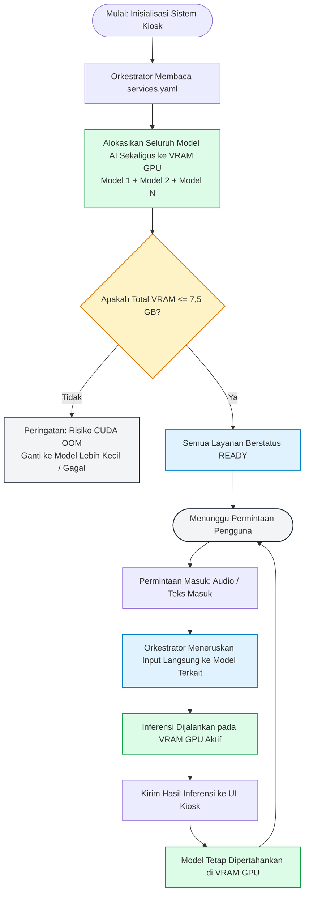
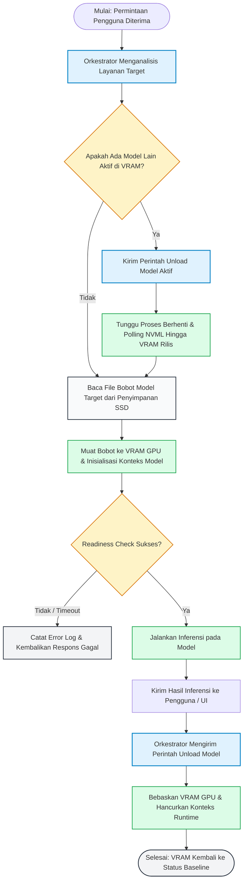
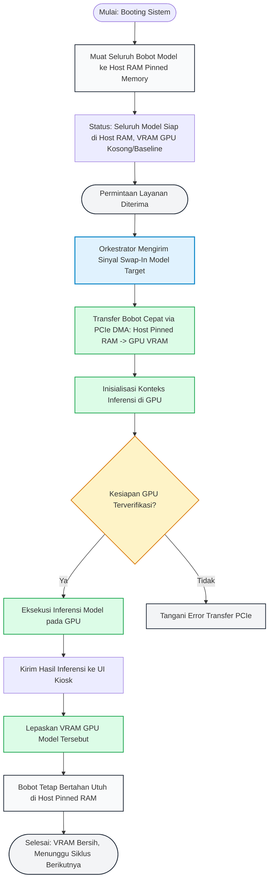
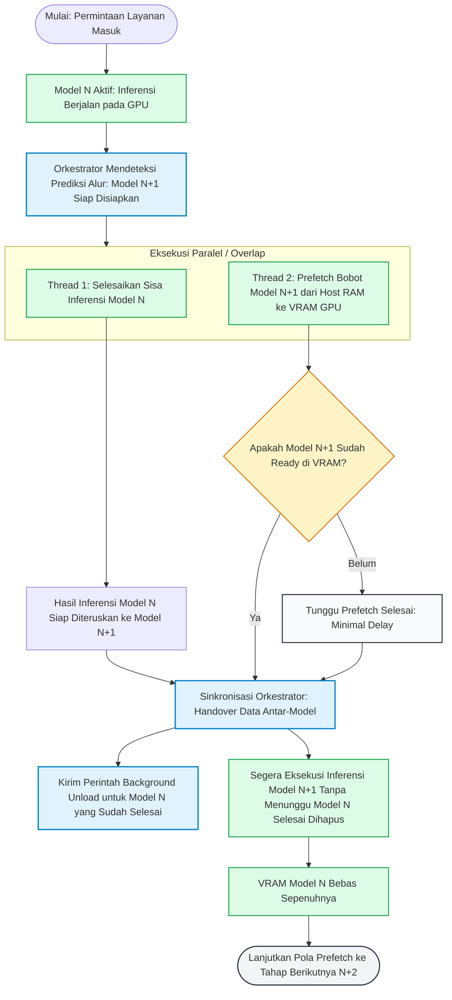

# Rencana Implementasi & Diagram Alur Empat Strategi Pengelolaan Model (Bab III)

Dokumen ini memuat perancangan alur kerja (*workflow/flowchart*) implementasi untuk **empat strategi pengelolaan siklus hidup model dan sumber daya GPU** pada Bab III Metodologi Penelitian. Seluruh diagram dirancang mengikuti kaidah visual naskah skripsi pada [writing.md](file:///c:/Users/User/Documents/AntiGravity/proof-concept-smartkiosk/writing.md), definisi metrik pada [METRICS.md](file:///c:/Users/User/Documents/AntiGravity/proof-concept-smartkiosk/docs/METRICS.md), serta batasan arsitektur pada [DECISIONS.md](file:///c:/Users/User/Documents/AntiGravity/proof-concept-smartkiosk/docs/DECISIONS.md).

---

## Ringkasan Perbandingan Karakteristik 4 Strategi

| Strategi | Lokasi Bobot saat Idle | Mekanisme saat Permintaan Datang | Kebutuhan Host RAM | Kebutuhan GPU VRAM | Ekspektasi Latensi Inferensi/Transisi |
|---|---|---|---|---|---|
| **(a) All-Resident** | VRAM GPU | Langsung inferensi (tanpa alokasi baru) | Rendah (hanya OS & backend) | Tinggi ($\sum \text{VRAM model} \le 7,5\text{ GB}$) | Terendah (tanpa *loading overhead*) |
| **(b) Naive Load/Unload** | Storage SSD / Disk | Baca dari Disk $\rightarrow$ Alokasi ke VRAM $\rightarrow$ Inferensi $\rightarrow$ Rilis VRAM | Rendah (tidak di-*cache* di RAM) | Rendah (hanya 1 model aktif pada satu waktu) | Tertinggi (terbebani I/O Disk & inisialisasi) |
| **(c) Pinned-Memory Swap** | Host RAM (*Pinned Memory*) | Salin memori via bus PCIe (Host-to-Device) $\rightarrow$ Inferensi $\rightarrow$ Rilis VRAM | Tinggi ($\sum \text{Bobot model} \le \text{RAM}$) | Dinamis (1 model aktif pada satu waktu) | Menengah (kecepatan PCIe 16–32 GB/s) |
| **(d) Prefetch** | Host RAM & VRAM Bersebelahan | Pemuatan tumpang tindih (*overlap*) sebelum model aktif selesai | Tinggi (RAM + VRAM pasangan model) | Menengah ($V_{\text{aktif}} + V_{\text{berikutnya}} \le 7,5\text{ GB}$) | Mendekati Strategi (a) dengan kapasitas model lebih besar |

---

## 1. Strategi (a): Semua Model Tetap Dimuat (All-Resident)

### 1.1 Penjelasan Operasional
Pada strategi ini, seluruh model AI yang diperlukan dimuat ke dalam VRAM GPU saat inisialisasi awal sistem (*startup*) dan dipertahankan (*resident*) secara permanen. Agar tidak melampaui batas 8 GB VRAM, model yang dipilih menggunakan varian bobot yang lebih ringkas (misal: model terkuantisasi intensif atau arsitektur parameter lebih kecil). Saat pengguna berinteraksi, orkestrator langsung meneruskan payload ke model yang sudah berada dalam status `READY`.

### 1.2 Flowchart Implementasi

---

## 2. Strategi (b): Pemuatan dan Pelepasan Naif (Naive Load/Unload)

### 2.1 Penjelasan Operasional
Strategi ini mengadopsi prinsip penggunaan sumber daya minimal pada satu waktu (*just-in-time loading*). Seluruh bobot model tersimpan pada media penyimpanan lokal (SSD). Saat suatu layanan dipanggil:
1. Model dimuat dari disk ke memori GPU.
2. Inferensi diproses.
3. Setelah selesai menghasilkan respons, model segera di-*unload* dan proses/alokasi VRAM dilepaskan kembali hingga mendekati nilai *baseline* sebelum melayani tahap berikutnya.

### 2.2 Flowchart Implementasi

---

## 3. Strategi (c): Pertukaran Memori Terpancang (Pinned-Memory Swap)

### 3.1 Penjelasan Operasional
Pada strategi ini, latensi I/O dari media penyimpanan (SSD) dieliminasi dengan mempertahankan bobot seluruh model di dalam **Host RAM yang dialokasikan sebagai Pinned (Page-Locked) Memory**. 
- Pinned memory mencegah sistem operasi melakukan *paging/swap* ke disk virtual, sehingga bus PCIe dapat melakukan transfer *Direct Memory Access* (DMA) langsung ke VRAM GPU dengan kecepatan penuh (mencapai ~15,8 GB/s pada PCIe 4.0 x8).
- Model dipindahkan ke VRAM saat dibutuhkan, dan saat selesai, alokasi VRAM dibebaskan kembali tanpa perlu membuang bobot dari Host RAM.

### 3.2 Flowchart Implementasi

---

## 4. Strategi (d): Pemuatan Awal Spekulatif (Prefetch)

### 4.1 Penjelasan Operasional
Strategi ini memanfaatkan ketergantungan sekuensial yang terprediksi pada alur interaksi kiosk (misal: saat Model N selesai memproses input, sistem hampir pasti mengeksekusi Model N+1).
- Total seluruh model mungkin tidak dapat ditampung bersamaan di VRAM 8 GB, namun **pasangan model bersebelahan muat secara simultan** dalam batas memori yang aman.
- Orkestrator memicu pemuatan awal (*prefetch*) model tahap berikutnya ke VRAM GPU secara asinkronus di latar belakang (*background thread*) ketika model tahap aktif sedang menyelesaikan inferensinya. Dengan demikian, waktu tunggu pemindahan memori tertutupi oleh waktu komputasi model aktif (*latency hiding*).

### 4.2 Flowchart Implementasi

---

## 5. Hubungan dengan Pengujian dan Evaluasi Bab IV

1. **Metrik Terkait:** Waktu aktivasi, transisi, dan latensi inferensi dari keempat alur di atas akan dicatat secara otomatis menggunakan instrumen yang terdefinisi pada [METRICS.md](file:///c:/Users/User/Documents/AntiGravity/proof-concept-smartkiosk/docs/METRICS.md) (`MTR-01` s.d. `MTR-07`).
2. **Kepatuhan Penulisan Naskah:** Format penulisan deskripsi alur pada Bab III wajib merujuk kaidah penulisan akademik dan ketentuan penyisipan gambar pada [writing.md](file:///c:/Users/User/Documents/AntiGravity/proof-concept-smartkiosk/writing.md).
