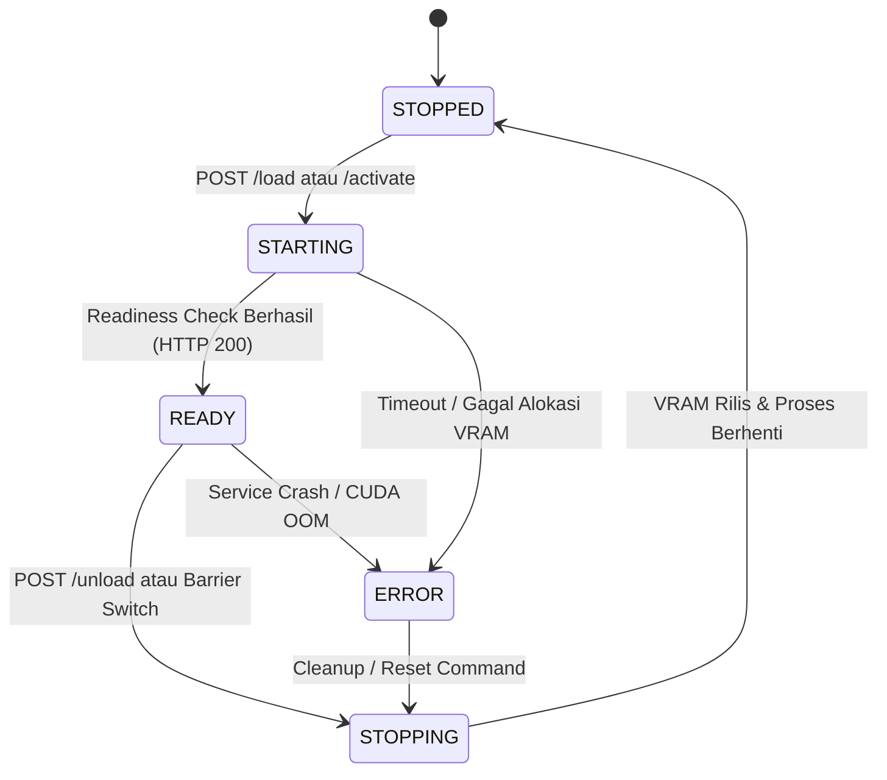

# 03_ORCHESTRATOR_CORE_M2.md — Arsitektur Inti Orchestrator & State Machine (Milestone M2)

> **Bagian dari:** [implementation.md](file:///c:/Users/User/Documents/AntiGravity/proof-concept-smartkiosk/implementation.md)  
> **Tahap:** Milestone M2 (Tugas Besar 2: AI Service Orchestrator)  
> **Target:** FastAPI Backend, Registry Konfigurasi, Lifecycle State Machine, REST/WebSocket Gateway

---

## 1. Tujuan Dokumen
Membangun modul **AI Service Orchestrator** yang bertindak sebagai otak pengelola layanan:
1. Membaca definisi metadata layanan dari berkas `configs/services.yaml`.
2. Mengelola siklus hidup status model (*Lifecycle State Machine*): `STOPPED`, `STARTING`, `READY`, `STOPPING`, dan `ERROR`.
3. Menyediakan antarmuka komunikasi RESTful untuk kontrol dan WebSocket untuk pembaruan status asinkronus ke UI Kiosk.
4. Mencegah tabrakan permintaan transisi bersamaan (*concurrency lock*).

---

## 2. Skema Registry Layanan (`configs/services.yaml`)

Definisi formal konfigurasi seluruh layanan yang dikelola Orchestrator:

```yaml
version: "1.0"
settings:
  vram_budget_mb: 7500
  readiness_timeout_seconds: 30
  sampling_interval_ms: 100

services:
  speech_pipeline:
    id: "speech_pipeline"
    name: "Percakapan Suara Asisten"
    type: "pipeline"
    endpoint: "http://127.0.0.1:8001"
    estimated_vram_mb: 3200
    is_exclusive: false
    health_path: "/health"
    load_path: "/load"
    unload_path: "/unload"
    infer_path: "/infer"

  fashion_recommendation:
    id: "fashion_recommendation"
    name: "Rekomendasi Busana Cerdas"
    type: "vlm_generator"
    endpoint: "http://127.0.0.1:8002"
    estimated_vram_mb: 4500
    is_exclusive: false
    health_path: "/health"
    load_path: "/load"
    unload_path: "/unload"
    infer_path: "/infer"

  virtual_tryon:
    id: "virtual_tryon"
    name: "Video Virtual Try-On"
    type: "visual_heavy"
    endpoint: "http://127.0.0.1:8003"
    estimated_vram_mb: 7200
    is_exclusive: true           # Memerlukan Exclusive GPU Mode
    health_path: "/health"
    load_path: "/load"
    unload_path: "/unload"
    infer_path: "/infer"

  photobooth:
    id: "photobooth"
    name: "AI Photobooth"
    type: "image_diffusion"
    endpoint: "http://127.0.0.1:8004"
    estimated_vram_mb: 6800
    is_exclusive: true           # Memerlukan Exclusive GPU Mode
    health_path: "/health"
    load_path: "/load"
    unload_path: "/unload"
    infer_path: "/infer"
```

---

## 3. Logika State Machine Siklus Hidup Layanan

Setiap layanan dimodelkan dengan mesin status строго terkontrol:



### Definisi Status:
- **`STOPPED`**: Model belum dimuat di VRAM GPU. Penggunaan memori 0 MB.
- **`STARTING`**: Perintah load dikirim; orkestrator sedang melakukan pooling readiness check hingga model siap.
- **`READY`**: Model telah selesai dimuat dan siap menerima payload inferensi instan.
- **`STOPPING`**: Model sedang dilepaskan dari VRAM. Orkestrator memverifikasi penurunan alokasi memori fisik via NVML.
- **`ERROR`**: Model gagal dimuat, terjadi timeout, atau mengalami CUDA OOM.

---

## 4. Implementasi Backend FastAPI & Endpoints

Simpan kode inti ini di `src/orchestrator/main.py`:

```python
import asyncio
import yaml
import httpx
from fastapi import FastAPI, HTTPException, WebSocket, WebSocketDisconnect
from fastapi.middleware.cors import CORSMiddleware
from pydantic import BaseModel

app = FastAPI(title="AI Service Orchestrator", version="1.0")

# Izinkan CORS untuk antarmuka web Chromium
app.add_middleware(
    CORSMiddleware,
    allow_origins=["*"],
    allow_credentials=True,
    allow_methods=["*"],
    allow_headers=["*"],
)

# Registry & State Storage
with open("configs/services.yaml", "r") as f:
    CONFIG = yaml.safe_load(f)

SERVICES = CONFIG["services"]
SERVICE_STATES = {k: "STOPPED" for k in SERVICES.keys()}
ACTIVE_SERVICE = None
ORCH_LOCK = asyncio.Lock()
CONNECTED_WEBSOCKETS = []

async def broadcast_status(event_type: str, data: dict):
    payload = {"event": event_type, "data": data, "states": SERVICE_STATES}
    for ws in CONNECTED_WEBSOCKETS:
        try:
            await ws.send_json(payload)
        except Exception:
            pass

@app.get("/health")
def health():
    return {"status": "UP", "active_service": ACTIVE_SERVICE}

@app.get("/services")
def list_services():
    return [
        {
            "id": s_id,
            "name": cfg["name"],
            "state": SERVICE_STATES[s_id],
            "estimated_vram_mb": cfg["estimated_vram_mb"],
            "is_exclusive": cfg["is_exclusive"]
        }
        for s_id, cfg in SERVICES.items()
    ]

@app.post("/services/{service_id}/activate")
async def activate_service(service_id: str):
    global ACTIVE_SERVICE
    if service_id not in SERVICES:
        raise HTTPException(status_code=404, detail="Service not found in registry")

    async with ORCH_LOCK:
        target = SERVICES[service_id]
        
        # Jika layanan sudah aktif dan siap, return langsung
        if ACTIVE_SERVICE == service_id and SERVICE_STATES[service_id] == "READY":
            return {"status": "SUCCESS", "message": f"{service_id} is already READY"}

        # 1. Hentikan layanan lama jika layanan target eksklusif atau ada layanan eksklusif aktif
        if ACTIVE_SERVICE and ACTIVE_SERVICE != service_id:
            old_id = ACTIVE_SERVICE
            SERVICE_STATES[old_id] = "STOPPING"
            await broadcast_status("STATE_CHANGE", {"service": old_id, "state": "STOPPING"})
            
            # Panggil unload pada layanan lama
            async with httpx.AsyncClient() as client:
                try:
                    await client.post(f"{SERVICES[old_id]['endpoint']}{SERVICES[old_id]['unload_path']}", timeout=10.0)
                except Exception as e:
                    print(f"Warning unloading {old_id}: {e}")
            
            SERVICE_STATES[old_id] = "STOPPED"
            await broadcast_status("STATE_CHANGE", {"service": old_id, "state": "STOPPED"})

        # 2. Mulai pemuatan layanan baru
        SERVICE_STATES[service_id] = "STARTING"
        await broadcast_status("STATE_CHANGE", {"service": service_id, "state": "STARTING"})
        
        async with httpx.AsyncClient() as client:
            try:
                # Trigger /load
                load_resp = await client.post(f"{target['endpoint']}{target['load_path']}", timeout=CONFIG["settings"]["readiness_timeout_seconds"])
                if load_resp.status_code == 200:
                    SERVICE_STATES[service_id] = "READY"
                    ACTIVE_SERVICE = service_id
                    await broadcast_status("STATE_CHANGE", {"service": service_id, "state": "READY"})
                    return {"status": "SUCCESS", "message": f"{service_id} is READY"}
                else:
                    raise Exception("Load returned non-200 status")
            except Exception as e:
                SERVICE_STATES[service_id] = "ERROR"
                await broadcast_status("STATE_CHANGE", {"service": service_id, "state": "ERROR", "error": str(e)})
                raise HTTPException(status_code=500, detail=f"Failed to activate {service_id}: {str(e)}")

@app.websocket("/ws/status")
async def websocket_status(websocket: WebSocket):
    await websocket.accept()
    CONNECTED_WEBSOCKETS.append(websocket)
    try:
        # Kirim status awal
        await websocket.send_json({"event": "INIT", "states": SERVICE_STATES, "active": ACTIVE_SERVICE})
        while True:
            # Pertahankan koneksi aktif
            await websocket.receive_text()
    except WebSocketDisconnect:
        CONNECTED_WEBSOCKETS.remove(websocket)
```

---

## 5. Kriteria Keberhasilan Milestone M2
- [ ] Backend FastAPI dijalankan pada port `8000` via Uvicorn.
- [ ] Endpoint `GET /services` mengembalikan seluruh daftar layanan dengan status `STOPPED` saat inisialisasi.
- [ ] Transisi `POST /services/{id}/activate` berhasil mengubah state dari `STOPPED` $\rightarrow$ `STARTING` $\rightarrow$ `READY`.
- [ ] Klien WebSocket menerima broadcast event status secara real-time.
