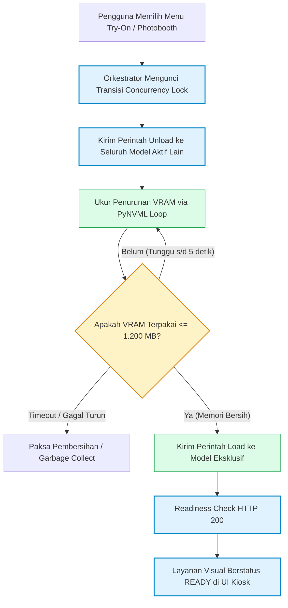

# 05_EXCLUSIVE_MODE_M3.md — Integrasi Layanan Visual & Penanganan Mode Eksklusif GPU (Milestone M3)

> **Bagian dari:** [implementation.md](file:///c:/Users/User/Documents/AntiGravity/proof-concept-smartkiosk/implementation.md)  
> **Tahap:** Milestone M3 (Integrasi Layanan Visual Berat)  
> **Target:** Video Virtual Try-On, AI Photobooth, Barrier State Machine, Pemulihan Error OOM

---

## 1. Masalah & Rasionalisasi Mode Eksklusif
Fitur pengolahan citra dan video cerdas—khususnya **Video Virtual Try-On** dan **AI Photobooth**—menggunakan model difusi dan jaringan saraf konvolusional berat yang membutuhkan alokasi memori mendekati batas fisik GPU RTX 5060:
- VRAM yang dibutuhkan: **6,5 – 7,8 GB**.
- Total VRAM fisik tersedia: **8,19 GB**.
- Sisa ruang untuk proses lain: **< 500 MB**.

Jika model percakapan (STT + LLM + TTS) dibiarkan tetap berada di VRAM saat layanan visual dipanggil, sistem dipastikan mengalami **CUDA Out of Memory (OOM)** fatal yang menyebabkan proses inferensi *crash*. Oleh karena itu, diterapkan **Exclusive GPU Mode**.

---

## 2. Alur Transisi Barrier (Barrier State Transition)

Saat pengguna berpindah dari mode percakapan/menu biasa ke mode visual eksklusif:



---

## 3. Implementasi Barrier Switch di Orkestrator

Simpan logika ini di `src/orchestrator/exclusive_barrier.py`:

```python
import time
import asyncio
import httpx
import pynvml

class ExclusiveBarrier:
    def __init__(self, services_config, nvml_handle, target_idle_threshold_mb=1200):
        self.services = services_config
        self.handle = nvml_handle
        self.threshold_mb = target_idle_threshold_mb

    def get_current_vram_used(self) -> float:
        mem_info = pynvml.nvmlDeviceGetMemoryInfo(self.handle)
        return mem_info.used / (1024 ** 2)

    async def switch_to_exclusive(self, target_service_id: str, active_service_id: str = None):
        """
        Melakukan transisi terkontrol ke mode eksklusif dengan garansi VRAM bersih.
        """
        # 1. Unload layanan aktif jika ada
        if active_service_id and active_service_id in self.services:
            old_svc = self.services[active_service_id]
            async with httpx.AsyncClient() as client:
                try:
                    await client.post(f"{old_svc['endpoint']}{old_svc['unload_path']}", timeout=10.0)
                except Exception as e:
                    print(f"Error during unload of {active_service_id}: {e}")

        # 2. Polling verifikasi pelepasan memori via NVML (maksimal 5 detik)
        t_start = time.perf_counter()
        vram_clean = False
        while time.perf_counter() - t_start < 5.0:
            current_vram = self.get_current_vram_used()
            if current_vram <= self.threshold_mb:
                vram_clean = True
                break
            await asyncio.sleep(0.2)

        if not vram_clean:
            print(f"Warning: VRAM ({current_vram:.1f} MB) is still above threshold ({self.threshold_mb} MB). Proceeding with caution.")

        # 3. Muat model eksklusif
        target_svc = self.services[target_service_id]
        async with httpx.AsyncClient() as client:
            resp = await client.post(
                f"{target_svc['endpoint']}{target_svc['load_path']}", 
                timeout=target_svc.get("timeout_seconds", 45.0)
            )
            if resp.status_code != 200:
                raise RuntimeError(f"Exclusive service {target_service_id} failed to load: {resp.text}")

        return {"status": "READY", "target": target_service_id, "vram_used_mb": self.get_current_vram_used()}
```

---

## 4. Jalur Pemulihan Kegagalan & Fallback (Graceful Degradation)

Jika model eksklusif gagal dimuat atau mengalami crash saat pengguna berinteraksi:
1. **Pemberitahuan UI:** Antarmuka web secara instan menangkap status `ERROR` via WebSocket dan menampilkan notifikasi ramah: *"Fitur fitting virtual sedang menyiapkan sistem. Silakan coba sesaat lagi atau gunakan layanan percakapan."*
2. **Auto-Cleanup:** Orkestrator memanggil `POST /unload` darurat pada model eksklusif.
3. **Reset ke Mode Standby:** Sistem secara otomatis memulihkan state ke `STOPPED` tanpa mengharuskan restart kiosk.

---

## 5. Kriteria Keberhasilan Milestone M3
- [ ] Transisi ke Virtual Try-On dan Photobooth berhasil melepas model lain terlebih dahulu.
- [ ] VRAM terpantau turun ke ambang aman ($\le 1.200\text{ MB}$) sebelum bobot model visual dimuat.
- [ ] Tidak terjadi insiden CUDA OOM saat berpindah bolak-balik antara mode percakapan dan mode visual.
