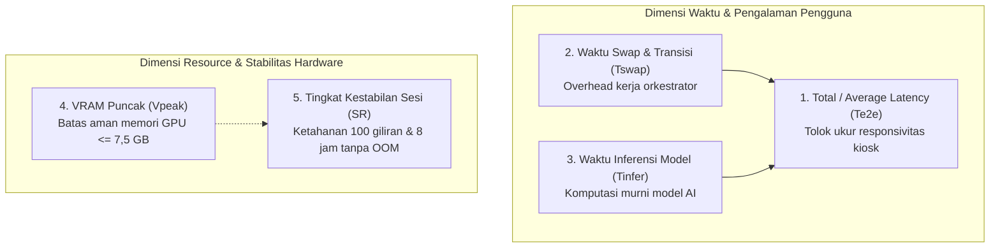

# METRICS.md — Spesifikasi dan Metrik Evaluasi Kinerja Sistem Orkestrasi

Dokumen ini mendefinisikan secara resmi **5 Metrik Evaluasi Kinerja Inti** yang menjadi patokan (*baseline*) keberhasilan tugas akhir dalam menguji efektivitas 4 strategi pengelolaan siklus hidup model AI pada GPU lokal (NVIDIA RTX 5060 8 GB VRAM).

> **Hubungan Antar-Dokumen:**
> - Rencana pengujian dan checklist milestone dirujuk di [CHECKPOINT.md](file:///c:/Users/User/Documents/AntiGravity/proof-concept-smartkiosk/docs/CHECKPOINT.md).
> - Keputusan teknis arsitektur dan penanganan mode eksklusif dicatat di [DECISIONS.md](file:///c:/Users/User/Documents/AntiGravity/proof-concept-smartkiosk/docs/DECISIONS.md).
> - Master context proyek dan batas tanggung jawab TA merujuk ke [CONTEXT.md](file:///c:/Users/User/Documents/AntiGravity/proof-concept-smartkiosk/CONTEXT.md).
> - Perancangan diagram alir 4 strategi merujuk ke [DIAGRAM_STRATEGI_PENGELOLAAN_MODEL.md](file:///c:/Users/User/Documents/AntiGravity/proof-concept-smartkiosk/docs/DIAGRAM_STRATEGI_PENGELOLAAN_MODEL.md).
> - Kaidah penulisan ilmiah dan visualisasi data merujuk ke [writing.md](file:///c:/Users/User/Documents/AntiGravity/proof-concept-smartkiosk/writing.md).

---

## 1. Landasan Pemilihan 5 Metrik Inti

Metrik evaluasi disesuaikan secara presisi untuk karakteristik **smart kiosk berbasis edge lokal** (1 pengguna fisik di depan layar, 1 GPU fisik 8 GB) berdasarkan fakta dokumen PoC (`PROOF_OF_CONCEPT.md` Bab 8 & 9) dan diselaraskan dengan standar literatur alokasi GPU IEEE (*Zhang et al., ComComAp 2025*).

Metrik yang tidak relevan untuk kiosk lokal—seperti biaya sewa cloud per detik (*cloud dollar cost*) dan *multi-user concurrent throughput* (rps)—dieliminasi dan digantikan dengan fokus pada **latensi interaksi**, **overhead orkestrasi**, **alokasi memori fisik**, dan **keandalan sesi**.



---

## 2. Rincian Lengkap 5 Metrik Penilaian Kinerja

---

### METRIK 1: Total / Average Latency ($T_{\text{e2e}}$)

#### a. Penjelasan
Mengukur total jeda waktu respons dari sudut pandang pengguna kiosk, yaitu dihitung sejak pengguna selesai memberikan masukan (misalnya selesai berbicara atau menekan tombol di antarmuka layar sentuh) hingga sistem mulai menyajikan respons pertama (misalnya suara pertama terdengar di speaker atau gambar pertama muncul di layar). Metrik ini mencerminkan kualitas interaksi kiosk secara menyeluruh.

#### b. Cara Mendapatkan Data
Dicatat menggunakan *high-resolution timer* (`time.perf_counter()`) pada lapisan API Gateway yang mengagregasikan cap waktu (*timestamp*) dari awal input selesai hingga paket respons pertama dikirimkan ke antarmuka pengguna:
```python
# Titik awal: saat Voice Activity Detection (VAD) mendeteksi akhir suara pengguna
t_input_end = time.perf_counter()

# Alur pemrosesan: Orkestrator menyiapkan model -> Model komputasi -> Output siap
# ...

# Titik akhir: saat chunk audio pertama dikirim ke audio buffer speaker
t_first_response = time.perf_counter()
t_e2e = t_first_response - t_input_end
```

#### c. Rumus Perhitungan
Secara langsung:
$$T_{\text{e2e}} = t_{\text{first\_response}} - t_{\text{input\_end}}$$

Dekomposisi komponen latensi pada alur sekuensial multi-tahap (misal Model 1 $\rightarrow$ Model 2 $\rightarrow$ Model 3):
$$T_{\text{e2e}} = \sum_{i=1}^{N} T_{\text{infer\_}i} + \sum_{j=1}^{N-1} T_{\text{swap\_}j} + T_{\text{network/buffer\_overhead}}$$
- Pada **Strategi (a) All-Resident:** Seluruh $T_{\text{swap}} = 0$, sehingga $T_{\text{e2e}}$ murni merupakan akumulasi inferensi dan overhead minimal.
- Pada **Strategi (d) Prefetch:** $T_{\text{swap}}$ berjalan secara tumpang tindih (*latency hiding*) di latar belakang, sehingga tidak menambah total waktu tunggu pengguna.

#### d. Kriteria Keberhasilan (Target PoC)
- **Target Ideal:** $\le 2,0\text{ detik}$ per giliran interaksi percakapan.
- **Batas Penerimaan Maksimum:** $\le 3,0\text{ detik}$ (di atas 3 detik interaksi kiosk mulai terasa canggung bagi pengguna).

---

### METRIK 2: Waktu Swap dan Transisi Model ($T_{\text{swap}}$)

#### a. Penjelasan
Mengukur durasi waktu yang dihabiskan oleh **orkestrator** untuk mengosongkan VRAM dari model sebelumnya dan menyiapkan model target ke VRAM GPU hingga model tersebut benar-benar lulus verifikasi kesiapan (*readiness check*) dan siap menerima payload inferensi. Metrik ini adalah **indikator langsung dari efisiensi algoritma orkestrator**.

#### b. Cara Mendapatkan Data
Diukur oleh orkestrator saat memicu siklus pergantian model (memanggil fungsi internal `unload` dan `load`):
```python
t_swap_start = time.perf_counter()

# 1. Kirim perintah terminasi / pelepasan model lama
# 2. Polling NVML hingga VRAM model lama terverifikasi turun ke batas aman
# 3. Panggil proses/runtime model target (via Disk SSD, Host RAM, atau Docker)
# 4. Tunggu HTTP 200 dari endpoint /health atau /ready model baru
t_swap = time.perf_counter() - t_swap_start
```

#### c. Rumus Perhitungan
$$T_{\text{swap}} = T_{\text{unload}} + T_{\text{verify\_vram}} + T_{\text{load\_to\_ready}}$$
- $T_{\text{unload}}$: waktu penghentian konteks model aktif sebelumnya.
- $T_{\text{verify\_vram}}$: waktu konfirmasi pembebasan alokasi VRAM oleh driver GPU via NVML.
- $T_{\text{load\_to\_ready}}$: waktu inisialisasi bobot model baru hingga siap menerima inferensi.

#### d. Perilaku Metrik pada 4 Strategi Pengelolaan GPU
Metrik ini berlaku untuk menguji seluruh strategi dari (a) hingga (d):
- **(a) All-Resident:** $T_{\text{swap}} \approx 0\text{ detik}$ (karena semua model selalu siaga di VRAM).
- **(b) Naive Load/Unload:** $T_{\text{swap}} \approx 2,0 - 5,0\text{ detik}$ (terhambat kecepatan I/O penyimpanan SSD dan inisialisasi context).
- **(c) Pinned-Memory Swap:** $T_{\text{swap}} \approx 0,2 - 0,5\text{ detik}$ (transfer langsung Host RAM $\rightarrow$ GPU VRAM via bus PCIe DMA berkecepatan ~15,8 GB/s).
- **(d) Prefetch:** $T_{\text{swap yang dirasakan pengguna}} \approx 0\text{ detik}$ (*latency hiding* berkat pemuatan paralel sebelum model aktif selesai).

#### e. Kriteria Keberhasilan (Target PoC)
- Pergantian antar-model sekuensial: $\le 0,5\text{ detik}$ (Batas toleransi: $\le 1,0\text{ detik}$).
- Pergantian ke Mode Eksklusif (Try-on / Photobooth): $\le 5,0\text{ detik}$ (Batas toleransi: $\le 10,0\text{ detik}$).

---

### METRIK 3: Waktu Inferensi Model ($T_{\text{infer}}$)

#### a. Penjelasan
Mengukur waktu komputasi murni yang dibutuhkan oleh sebuah model AI untuk memproses input masukan menjadi keluaran lengkap saat model **sudah berada dalam status `READY` di VRAM GPU**. Metrik ini membuktikan bahwa orkestrator tidak mengganggu kecepatan komputasi intrinsik model.

#### b. Cara Mendapatkan Data
Dicatat langsung pada lapisan adapter layanan atau gateway dengan menghitung durasi request-response inferensi:
```python
t_infer_start = time.perf_counter()
response = service_client.post("/infer", json=payload_input)
t_infer = time.perf_counter() - t_infer_start
```
- *Untuk model berbasis streaming (seperti model bahasa):* dicatat juga **Time-to-First-Token (TTFT)**, yaitu waktu dari prompt diterima hingga token pertama dikembalikan ke client.

#### c. Rumus Perhitungan
$$T_{\text{infer}} = t_{\text{output\_selesai}} - t_{\text{input\_diterima}}$$

Untuk keluaran streaming (TTFT):
$$T_{\text{TTFT}} = t_{\text{token\_pertama}} - t_{\text{input\_diterima}}$$

#### d. Kriteria Keberhasilan (Acuan Target PoC)
- Komputasi inferensi per tahap sekuensial: $\le 300 - 800\text{ ms}$.
- Inferensi model visual eksklusif:
  - Video Try-On: $\ge 8 - 15\text{ FPS}$ (atau jeda pemrosesan frame $\le 70 - 120\text{ ms}$).
  - AI Photobooth: $\le 30\text{ detik}$ per foto lengkap.

---

### METRIK 4: Penggunaan VRAM Puncak ($V_{\text{peak}}$)

#### a. Penjelasan
Mengukur pemakaian memori fisik kartu grafis NVIDIA RTX 5060 tertinggi yang teralokasi selama sistem beroperasi, baik saat model sedang inferensi maupun saat terjadi transisi tumpang tindih (*prefetch overlap*). Metrik ini menjadi tolok ukur apakah alokasi sumber daya mematuhi batas perangkat keras fisik 8 GB.

#### b. Cara Mendapatkan Data
Menggunakan pustaka resmi NVIDIA Management Library (`pynvml`) yang dijalankan pada *background thread* independen dengan frekuensi cuplikan (*sampling rate*) setiap 50–100 ms:
```python
import pynvml

pynvml.nvmlInit()
handle = pynvml.nvmlDeviceGetHandleByIndex(0)

# Dicuplik secara kontinu selama eksperimen berlangsung
mem_info = pynvml.nvmlDeviceGetMemoryInfo(handle)
vram_terpakai_mb = mem_info.used / (1024 ** 2)
```

#### c. Rumus Perhitungan
$$V_{\text{peak}} = \max_{t \in [t_{\text{awal}}, t_{\text{akhir}}]} V(t)$$
Di mana $V(t)$ adalah deret sampel alokasi VRAM pada waktu $t$.

#### d. Kriteria Keberhasilan (Target PoC)
$$V_{\text{peak}} \le 7,5\text{ GB} \quad (7.680\text{ MB})$$
Menyisakan batas aman (*headroom*) minimal 500 MB untuk frame buffer layar sentuh 32 inci (1080 $\times$ 1920) dan compositor sistem operasi Ubuntu GNOME.

---

### METRIK 5: Tingkat Kestabilan Sesi ($SR$ / *Stability Rate*)

#### a. Penjelasan
Mengukur kemampuan orkestrator dalam menjaga keandalan kiosk agar tidak mengalami kegagalan fatal (*fatal crash*), kebocoran alokasi VRAM (*memory leak*), atau kondisi kehabisan memori (*CUDA Out of Memory*) selama penggunaan berulang dalam jangka panjang.

#### b. Cara Mendapatkan Data
Dijalankan menggunakan skrip pengujian otomatis (*automated benchmark harness*) yang menyimulasikan siklus interaksi berulang secara berturut-turut, kemudian menghitung rasio sesi yang berhasil diselesaikan tanpa gangguan:
```python
total_sesi = len(log_hasil_uji)
sesi_sukses = sum(1 for log in log_hasil_uji if log["status"] == "SUCCESS")
stability_rate = (sesi_sukses / total_sesi) * 100.0
```

#### c. Rumus Perhitungan
$$SR = \left( \frac{N_{\text{sukses}}}{N_{\text{total}}} \right) \times 100\%$$
Di mana kegagalan didefinisikan jika terjadi salah satu dari:
1. Insiden *CUDA Out of Memory* (OOM).
2. HTTP 504 Gateway Timeout (proses macet melebihi batas toleransi).
3. Proses model mengalami *crash* atau *exit code non-zero*.

#### d. Kriteria Keberhasilan (Target PoC)
- **Uji Percakapan Berulang:** $100\text{ giliran berturut-turut}$ dengan $SR = 100\%$ (0 kali OOM).
- **Uji Daya Tahan Kiosk:** Beroperasi aktif terus menerus selama **8 jam** tanpa akumulasi residual VRAM yang menyebabkan aplikasi harus di-restart.

---

## 3. Matriks Perbandingan 4 Strategi Pengelolaan GPU terhadap 5 Metrik Inti

Tabel ini merangkum trade-off teoritis dan hipotesis eksperimen yang akan dibuktikan di Bab IV:

| Strategi Pengelolaan GPU | 1. $T_{\text{swap}}$ (Swap Time) | 2. $T_{\text{infer}}$ (Inference Time) | 3. $T_{\text{e2e}}$ (Total Latency) | 4. $V_{\text{peak}}$ (Puncak VRAM) | 5. $SR$ (Tingkat Kestabilan) | Analisis Trade-off Rekayasa |
|---|---|---|---|---|---|---|
| **(a) All-Resident** | $\approx 0\text{ s}$ (Paling Cepat) | Cepat (karena model berbobot kecil) | Terendah ($\approx 1,5 - 2,0\text{ s}$) | Tertinggi ($\approx 7,0 - 7,5\text{ GB}$) | Rentan OOM jika model diperbesar | **Kelebihan:** Latensi instan.<br/>**Kelemahan:** Memaksa model berukuran kecil agar muat bersamaan di VRAM 8 GB. |
| **(b) Naive Load/Unload** | 2,0 – 5,0 s (Paling Lambat) | Standar | Tertinggi ($> 5,0\text{ s}$) | Terendah ($\approx 2,5 - 4,0\text{ GB}$) | Sangat stabil dari OOM | **Kelebihan:** VRAM sangat longgar dan aman.<br/>**Kelemahan:** Terhambat I/O storage SSD, latensi melampaui batas wajar kiosk. |
| **(c) Pinned-Memory Swap** | 0,2 – 0,5 s (Cepat via PCIe) | Standar | Rendah ($\approx 2,5 - 3,0\text{ s}$) | Dinamis (1 model di VRAM) | Bergantung ketersediaan Host RAM | **Kelebihan:** Waktu swap sangat cepat tanpa terhambat SSD.<br/>**Kelemahan:** Membutuhkan kapasitas Host RAM besar ($\ge 16 - 32\text{ GB}$) dan dukungan API runtime. |
| **(d) Prefetch** | $\approx 0\text{ s}$ (*Latency Hiding*) | Standar | Sangat Rendah ($\approx 1,8 - 2,2\text{ s}$) | Menengah ($\approx 5,0 - 6,5\text{ GB}$) | Memerlukan sinkronisasi thread | **Kelebihan:** Latensi mendekati (a) namun dapat menggunakan model berkapasitas lebih baik.<br/>**Kelemahan:** Logika orkestrasi lebih kompleks untuk menangani konkurensi alokasi. |

---

## 4. Protokol Pencatatan Data Mentah Benchmark

Setiap baris data pengujian dicatat secara otomatis dalam berkas log `.jsonl` atau `.csv` pada direktori `results/` dengan struktur atribut standar:
```text
run_id, timestamp, strategy, model_name, cache_state, swap_duration_ms, infer_duration_ms, e2e_latency_ms, peak_vram_mb, status, error_detail
```
- Setiap kondisi eksperimen wajib dijalankan minimal **10 kali pengulangan** ($N \ge 10$) dalam kondisi terkontrol (memisahkan *Cold Run* dan *Warm Run*).
- Hasil yang dilaporkan pada naskah skripsi Bab IV wajib mencakup: Nilai Rata-rata (*Mean*), Median, Simpangan Baku (*Standard Deviation*), Nilai Minimum, dan Nilai Maksimum.
