# pipeline.md — Workflow & Pipeline 3 Tugas Besar

> **Lokasi:** `docs/pipeline.md`  
> **Fungsi:** Spesifikasi alur kerja, saluran komunikasi antar-modul, dan protokol data dari 3 Tugas Besar (TB1: Kiosk UI, TB2: Orchestrator, TB3: Resource Management).  
> **Kapan AI membaca:** Saat memahami aliran data end-to-end, format request/response, atau integrasi antarmuka.

---

## 1. Arsitektur Komunikasi Antar-Tugas Besar

```mermaid
flowchart LR
    classDef tb1 fill:#E0F2FE,stroke:#0284C7,stroke-width:2px
    classDef tb2 fill:#FEF3C7,stroke:#D97706,stroke-width:2px
    classDef tb3 fill:#DCFCE7,stroke:#16A34A,stroke-width:2px
    classDef hw fill:#F3F4F6,stroke:#1F2937,stroke-width:1.5px

    USER([Pengguna Kiosk]):::hw <-->|Sentuhan, Suara, Kamera| TB1[TB 1: UI/UX Chromium Kiosk<br/>Portrait 9:16 HTML5/JS]:::tb1
    TB1 <-->|HTTP REST /activate & WebSocket /ws/events| TB2[TB 2: AI Service Orchestrator<br/>FastAPI & State Machine]:::tb2
    TB2 <-->|Dispatch Strategi & Lock Barrier| TB3[TB 3: Resource Management<br/>4 Strategi & PyNVML Sampler]:::tb3
    TB3 <-->|Alokasi VRAM & Eksekusi Inferensi| GPU[GPU NVIDIA RTX 5060 8 GB<br/>Local AI Microservices]:::hw
```



---

## 2. Aliran Data per Skenario Layanan

### 2.1 Aliran Percakapan Suara (Turn-Taking Voice Pipeline)
1. **Input:** Mikrofon menangkap suara ucapan pengguna $\rightarrow$ VAD mendeteksi akhir suara.
2. **TB1 ke TB2:** UI mengirim payload audio via WebSocket `/ws/audio` atau REST `/api/v1/infer/speech`.
3. **TB2 ke TB3:** Orchestrator memvalidasi status model suara. Jika belum di VRAM, TB3 memuat model sesuai strategi aktif (A, B, C, atau D).
4. **Eksekusi AI:**
   - **STT (Faster-Whisper):** Mengubah gelombang audio menjadi teks transkripsi.
   - **LLM (Qwen/Llama GGUF):** Menerima teks dan konteks RAG, menghasilkan teks respons secara streaming.
   - **TTS (Piper):** Mengonversi kalimat respons menjadi aliran audio sintesis.
5. **Output:** Aliran audio dikirim kembali via WebSocket ke TB1 untuk diputar di pengeras suara, sementara teks transkripsi ditampilkan di layar potret.

### 2.2 Aliran Rekomendasi Busana (Two-Stage Pipeline)
1. **Input:** Kamera menangkap foto postur pengguna di Zona B (1,6–2,2 meter).
2. **Tahap 1 (VLM):** Model VLM diaktifkan untuk menganalisis karakteristik pakaian pengguna dan memilih rekomendasi busana dari katalog. Hasil analisis teks segera disajikan ke layar.
3. **Pembersihan Antartahap:** Model VLM dilepas dari VRAM untuk memberi ruang bagi model difusi gambar.
4. **Tahap 2 (Diffusion Generation):** Model difusi menghasilkan citra pengguna dengan busana baru secara bertahap dan menampilkannya pada galeri foto UI Kiosk.

### 2.3 Aliran Mode Eksklusif (Virtual Try-On Video & AI Photobooth)
1. **Trigger:** Pengguna memilih menu Try-On atau Photobooth.
2. **Barrier State Transition (TB2 & TB3):**
   - Orchestrator mengirim sinyal `UNLOAD` ke seluruh model percakapan.
   - TB3 melakukan polling NVML hingga alokasi VRAM terverifikasi turun ke batas aman baseline ($\le 1,0\text{ GB}$).
   - TB3 mengalokasikan memori penuh untuk model eksklusif.
3. **Eksekusi Mode Eksklusif:** Model video try-on atau photobooth memegang 100% kapasitas VRAM secara eksklusif selama sesi interaksi.
4. **Pemulihan Sesi:** Saat sesi berakhir atau timeout tercapai, model eksklusif dilepas dari VRAM, diverifikasi bersih, dan mode percakapan siap diaktifkan kembali tanpa restart sistem.

---

## 3. Protokol & Format Pertukaran Data

### 3.1 Kontrak REST API Standar
- `GET /health` $\rightarrow$ Status kesehatan proses dan ketersediaan layanan.
- `POST /api/v1/mode/switch` $\rightarrow$ Request transisi mode (`{"target_mode": "exclusive_tryon"}`).
- `POST /api/v1/infer/{service_id}` $\rightarrow$ Eksekusi payload inferensi model.
- `GET /api/v1/metrics/live` $\rightarrow$ Snapshot penggunaan VRAM, RAM, CPU, dan status worker.

### 3.2 Event WebSocket (`/ws/events`)
Format JSON standar untuk pembaruan status asinkronus ke UI:
```json
{
  "event_type": "MODEL_STATUS_CHANGED",
  "service_id": "speech_llm",
  "state": "READY",
  "vram_used_mb": 3450,
  "timestamp": 1731930000.123
}
```
