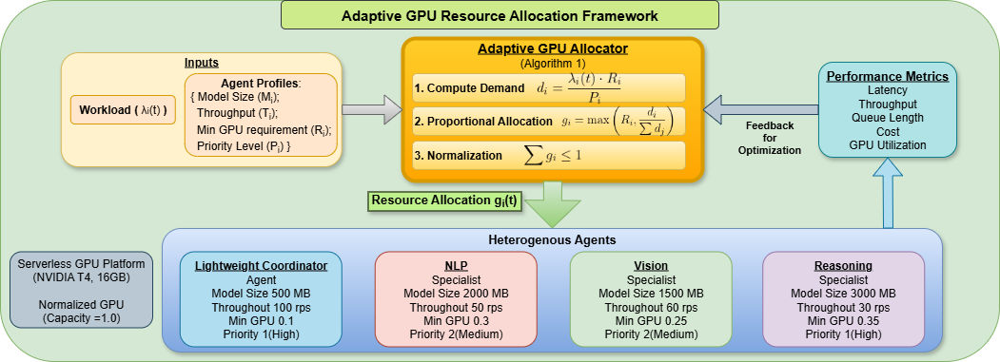
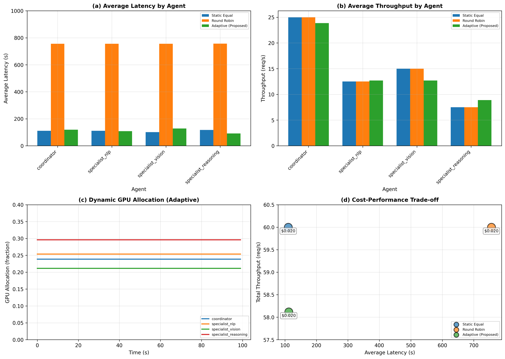

# Analisis Paper: Adaptive GPU Resource Allocation for Multi-Agent Collaborative Reasoning in Serverless Environments

> **File Asli:** `docs/Adaptive_GPU_Resource_Allocation_for_Multi-Agent_Collaborative_Reasoning_in_Serverless_Environments.pdf` (6 Halaman)  
> **Penulis:** Guilin Zhang, Wulan Guo, Ziqi Tan (George Washington University, USA, 2024/2025)  
> **Relevansi Utama untuk TA Rendy:** Paper ini membahas **alokasi sumber daya GPU adaptif pada lingkungan serverless/multi-agent** dengan beban kerja heterogen (koordinator ringan vs model inferensi berat), sangat relevan sebagai referensi ilmiah Bab II dan dasar perancangan orkestrator adaptif.

---

## 1. Intisari Penelitian & Kontribusi Utama
- **Permasalahan Utama:** Menjalankan sistem *multi-agent* berbasis LLM yang berkolaborasi pada platform serverless GPU menghadapi tantangan:
  1. *Heterogeneous computational demands:* Perbedaan ekstrem antara agen koordinator (ringan, frekuensi tinggi) dan agen spesialis (berat, pemrosesan mendalam).
  2. *Dynamic workload fluctuations:* Fluktuasi beban yang membutuhkan realokasi GPU dalam skala milidetik.
  3. *Capacity constraints:* Batasan kapasitas GPU fisik yang tidak boleh terlampaui.
- **Solusi yang Diusulkan:** Framework alokasi GPU adaptif berbasis algoritma ber-kompleksitas $\mathcal{O}(N)$ yang secara dinamis membagi alokasi GPU berdasarkan karakteristik beban, prioritas agen, dan batas sumber daya minimum.
- **Hasil Kuantitatif:**
  - Menurunkan latensi hingga **85%** dibandingkan penjadwalan *Round-Robin*.
  - Mempertahankan throughput yang setara dengan alokasi statis namun menghemat biaya komputasi secara signifikan.

---

## 2. Diagram & Arsitektur Sistem (Aset Asli Paper)

### 2.1 Arsitektur Framework Kolaborasi Multi-Agent
Arsitektur ini membagi alur kerja menjadi Coordinator Agent, Specialist Agents (Language, Vision, Reasoning), serta Resource Orchestration Engine.

*Deskripsi Diagram:*
- **Input Tasks:** Masuk ke *Coordinator Agent*.
- **Task Decomposition & Delegation:** Coordinator memecah tugas ke agen spesialis.
- **Resource Monitor:** Memantau GPU util, memory headroom, dan queue length.
- **Adaptive Allocation Engine:** Algoritma $\mathcal{O}(N)$ menghitung pembagian kuota/prioritas GPU secara real-time.

---

### 2.2 Evaluasi Komparatif Kinerja & Throughput

  

*Temuan Evaluasi:*
1. **Perbandingan Latensi:** Alokasi adaptif secara konsisten mengungguli *Static Equal Allocation* dan *Round-Robin Scheduling* terutama saat beban puncak.
2. **Efisiensi Memori/GPU:** Mencegah terjadinya *resource starvation* pada agen yang berada pada jalur kritis (*critical reasoning path*).

---

## 3. Relevansi & Pemanfaatan dalam Tugas Akhir Rendy (Smart Kiosk)

| Aspek pada Paper (Zhang et al.) | Korelasi Langsung pada TA Smart Kiosk Rendy |
|---|---|
| **Agen Heterogen (Coordinator vs Specialist)** | Pola layanan Kiosk: Agen Percakapan (STT $\rightarrow$ LLM $\rightarrow$ TTS) vs Model Visual Berat (Try-on Video & Photobooth). |
| **Algoritma Alokasi $\mathcal{O}(N)$ Ringan** | Orkestrator Python Rendy harus mengambil keputusan switching dalam waktu < 50 ms tanpa membebani CPU host. |
| **Pencegahan Starvation & OOM** | Kebijakan *Exclusive GPU Mode* (ADR-004) dan *Readiness Barrier* untuk memastikan GPU 8 GB tidak crash. |
| **Kandidat Sitasi Bab II** | Sangat ideal dijadikan referensi penguat pada Bab II (Subbab 2.2 Landasan Teori Alokasi Sumber Daya GPU / Edge Serving). |
