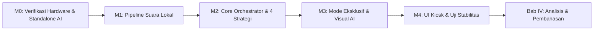

# research_roadmap.md — Peta Jalan Riset & Milestone (M0–M4)

> **Lokasi:** `docs/research_roadmap.md`  
> **Fungsi:** Peta tahapan riset dari Milestone M0 hingga M4, kriteria kelulusan, dan pemetaan ke bab laporan skripsi.  
> **Kapan AI membaca:** Saat memeriksa gambaran besar tahapan proyek, merencanakan tugas baru, atau memverifikasi kriteria selesai.

---

## 1. Ikhtisar Tahapan Riset

---

## 2. Rincian Milestone Pelaksanaan

### Milestone M0: Verifikasi Lingkungan & Audit Fisik Hardware
- **Fokus:** Pemeriksaan fisik Mini PC ASRock DeskMeet (X600 vs X300, link PCIe 4.0 x8, RAM DDR5, GPU RTX 5060 8 GB, layar sentuh potret 32", mic array, webcam 1080p).
- **Pengujian Mandiri:** Menjalankan model STT, LLM, TTS, dan visual secara mandiri untuk merekam data baseline ($V_{\text{peak}}$, load time, waktu komputasi).
- **Keluaran:** Dokumen inventaris hardware aktual, baseline tabel kebutuhan VRAM, dan konfigurasi driver/CUDA terverifikasi.
- **Kriteria Lulus:** Semua periferal terdeteksi OS Linux Ubuntu; seluruh model kandidat dapat berjalan mandiri pada RTX 5060 tanpa crash awal.

### Milestone M1: Baseline Pipeline Suara Lokal
- **Fokus:** Integrasi berurutan STT $\rightarrow$ LLM $\rightarrow$ TTS secara lokal tanpa ketergantungan API cloud.
- **Pengujian:** Rekaman audio uji seragam (Bahasa Indonesia & Inggris); pencatatan timestamp akhir ucapan, teks transkripsi, token pertama LLM, dan audio sintesis pertama.
- **Keluaran:** Log latensi baseline per tahap dan latensi ujung-ke-ujung ($T_{\text{e2e}}$).
- **Kriteria Lulus:** Percakapan suara lokal dua arah berhasil dieksekusi dengan model terverifikasi.

### Milestone M2: Core Orchestrator & Komparasi 4 Strategi GPU
- **Fokus:** Pembangunan API Gateway (FastAPI REST + WebSocket), registry konfigurasi (`configs/services.yaml`), Lifecycle State Machine, continuous NVML sampler, dan implementasi 4 strategi pengelolaan GPU (A: All-Resident, B: Naive, C: Pinned Swap, D: Prefetch).
- **Pengujian:** Automated benchmark harness menjalankan 10 pengulangan per kondisi uji.
- **Keluaran:** Data mentah komparasi 4 strategi (`results/`), modul core orkestrator teruji.
- **Target PoC:** 100 giliran percakapan berturut-turut tanpa insiden CUDA OOM dengan VRAM $\le 7,5\text{ GB}$.

### Milestone M3: Integrasi Layanan Visual & Mode Eksklusif
- **Fokus:** Mengintegrasikan domain visual (Rekomendasi Busana, Video Virtual Try-On, AI Photobooth) dengan mekanisme penghalang (*barrier state transition*) dan verifikasi pembersihan VRAM via NVML.
- **Pengujian:** Siklus transisi: Percakapan $\rightarrow$ Busana $\rightarrow$ Try-On $\rightarrow$ Photobooth $\rightarrow$ Percakapan pulih.
- **Keluaran:** Log transisi mode, verifikasi pembebasan memori GPU, jalur pemulihan error/timeout.
- **Kriteria Lulus:** Transisi ke dan dari mode eksklusif berjalan tanpa memerlukan restart aplikasi kiosk.

### Milestone M4: Integrasi Web UI Kiosk & Pengujian Stabilitas
- **Fokus:** Antarmuka web potret 9:16 di Chromium Kiosk Fullscreen, integrasi event WebSocket real-time, visualisasi status kesiapan model, autostart sistem, dan uji ketahanan jangka panjang.
- **Pengujian:** Demo alur penuh end-to-end oleh pengguna baru dan uji daya tahan hingga 8 jam.
- **Keluaran:** Sistem terintegrasi penuh siap uji operasional dan naskah Bab IV berbasis data empiris.
- **Kriteria Lulus:** Kiosk beroperasi stabil selama sesi pengujian panjang tanpa memory leak yang memicu kegagalan fatal.

---

## 3. Pemetaan Tahapan ke Naskah Laporan Skripsi

| Milestone | Bahan Naskah Skripsi |
|---|---|
| **M0 & M1** | Bab 3.2 (Bahan & Peralatan), Bab 3.3.1–3.3.2 (Urutan Penelitian), Bab 4.1–4.2 (Setup & Baseline) |
| **M2** | Bab 3.3.3–3.3.5 (Perancangan Orchestrator & Strategi), Bab 4.3 (Komparasi 4 Strategi GPU) |
| **M3** | Bab 3.3.6 (Manajemen Mode Eksklusif), Bab 4.4 (Evaluasi Transisi Mode) |
| **M4** | Bab 3.3.7–3.3.8 (Integrasi & Benchmark Akhir), Bab 4.5–4.6 (Stabilitas & Pembahasan), Bab V (Kesimpulan) |
