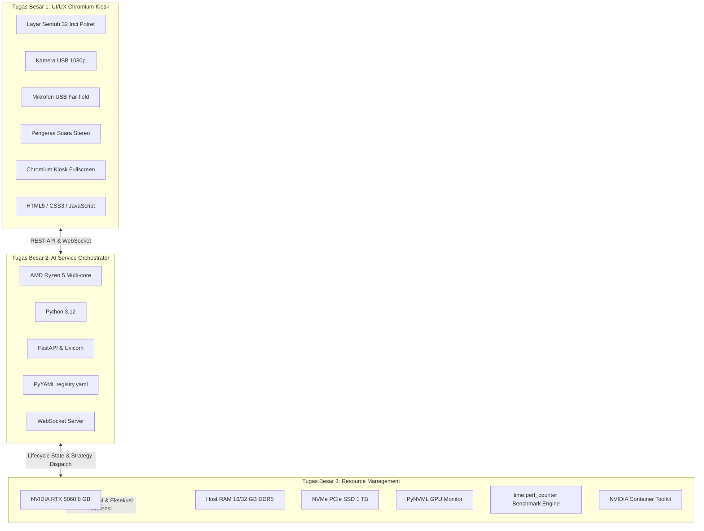

# TECH_STACK.md — Spesifikasi Perangkat Keras dan Perangkat Lunak (Bab 3.2)

Dokumen ini mendefinisikan secara komprehensif seluruh komponen **Bahan dan Peralatan (Tech Stack)** yang digunakan dalam penelitian Tugas Akhir:  
**“Sistem Orkestrasi Layanan AI Berbasis Microservices pada Sistem Smart Kiosk”** (Rendy Lexxy Kurniawan - NRP 5024231007).

Setiap komponen dipetakan secara eksplisit ke dalam **tiga tugas besar (modul)**:
1. **Tugas Besar 1:** UI/UX Aplikasi Web Browser Chromium Kiosk (Layar sentuh potret 9:16).
2. **Tugas Besar 2:** AI Service Orchestrator (API Gateway, routing, registry, dan state machine lifecycle).
3. **Tugas Besar 3:** Resource Management (Eksekusi 4 strategi memori GPU, pemantauan NVML, dan logging 5 metrik evaluasi).

---

## 1. Spesifikasi Perangkat Keras (Hardware)

| No | Komponen Perangkat Keras | Spesifikasi Teknis | Pemetaan Tugas Besar (Use Case) | Peran dan Fungsi Teknis |
|---|---|---|---|---|
| **1** | **Unit Komputer Edge (Mini PC)** | ASRock DeskMeet X600 (AM5, form factor 8 liter, PSU internal 500W) | Seluruh Tugas Besar (TB 1, TB 2, TB 3) | Unit pemrosesan lokal terpadu (*standalone edge*) untuk mengeksekusi antarmuka, orkestrator, dan seluruh proses inferensi AI secara lokal tanpa ketergantungan cloud API. |
| **2** | **Prosesor Utama (CPU)** | AMD Ryzen 5 (Zen 4, multi-core, arsitektur 64-bit) | TB 2 (Orchestrator) & TB 3 (Resource Management) | Menjalankan event-loop FastAPI, background thread pemantau NVML, pembacaan konfigurasi registry YAML, dan penanganan I/O socket secara asinkronus. |
| **3** | **Memori Utama Sistem (Host RAM)** | 16 GB DDR5 (dapat ditingkatkan ke 32 GB dual-channel) | TB 3 (Resource Management) & TB 2 | Menampung buffer sistem operasi, page cache, serta menjadi media penyimpanan bobot model terpancang (*pinned memory*) pada **Strategi (c)** dan **Strategi (d)** via bus PCIe. |
| **4** | **Penyimpanan Primer (Storage)** | NVMe PCIe SSD 1 TB | Seluruh Tugas Besar (TB 1, TB 2, TB 3) | Menyimpan sistem operasi Ubuntu, source code backend/frontend, file bobot model AI, dan berkas log hasil pengujian benchmark (CSV/JSONL). Menjadi sumber I/O utama pada **Strategi (b)**. |
| **5** | **Unit Pemrosesan Grafis (GPU Fisik)** | NVIDIA GeForce RTX 5060 Low Profile (Arsitektur Blackwell, 8 GB GDDR6/GDDR7 VRAM, PCIe 4.0 x8) | TB 3 (Resource Management) & Eksekusi AI | Perangkat keras utama yang menjadi objek pengelolaan memori dan akselerasi komputasi paralel bagi seluruh model AI lokal. Alokasi VRAM dibatasi ketat $\le 7,5\text{ GB}$. |
| **6** | **Perangkat Layar Sentuh Kiosk** | Monitor Layar Sentuh Potret 32 inci (Resolusi Full HD $1080 \times 1920$, HDMI + USB Touch Controller) | TB 1 (UI/UX Chromium Kiosk) | Media interaksi visual utama pengguna. Menampilkan antarmuka fullscreen 9:16 dan menangkap input sentuhan pengguna melalui driver kernel Linux. |
| **7** | **Kamera Digital USB** | Webcam USB 1080p @ 30 FPS (Format UVC/MJPEG, rotasi 90 derajat potret) | TB 1 (UI/UX Kiosk) | Sensor masukan visual pengguna untuk kebutuhan deteksi keberadaan, masukan analisis busana, dan aliran video langsung pada mode cermin *virtual try-on*. |
| **8** | **Mikrofon USB Array** | USB Far-field Microphone Array (dilengkapi hardware *Echo Cancellation*) | TB 1 (UI/UX Kiosk) | Sensor masukan audio suara pengguna untuk layanan percakapan. Fitur echo cancellation mencegah suara keluaran speaker masuk kembali ke mikrofon. |
| **9** | **Pengeras Suara (Speaker)** | Soundbar / USB Speaker stereo aktif | TB 1 (UI/UX Kiosk) | Perangkat keluaran audio untuk memperdengarkan respons suara sintesis AI kepada pengguna kios cerdas. |

---

## 2. Spesifikasi Perangkat Lunak (Software)

### 2.1 Sistem Operasi
- **Sistem Operasi:** Linux Ubuntu Desktop (GNOME Display Manager, kernel versi 6.x LTS).
- **Use Case / Peran Teknis:**
  - **TB 1:** Menyediakan lingkungan compositor grafis X11/Wayland untuk menjalankan peramban Chromium dalam mode kios layar penuh (*fullscreen kiosk*).
  - **TB 2 & 3:** Menyediakan subsistem kernel Linux, kontrol proses POSIX, pengelolaan alokasi memori halaman (*paging/cgroups*), dan antarmuka driver perangkat keras.

### 2.2 Bahasa Pemrograman
- **Python (versi 3.12+):**
  - **Use Case:** Digunakan secara eksklusif untuk **TB 2 (AI Service Orchestrator)** dan **TB 3 (Resource Management)**.
  - **Peran Teknis:** Mengimplementasikan backend API Gateway, logika State Machine, pembacaan konfigurasi registry, pemanggilan thread NVML, serta skrip otomatisasi benchmark evaluasi kinerja.
- **HTML5, CSS3, dan Modern JavaScript (ECMAScript 2023+):**
  - **Use Case:** Digunakan secara eksklusif untuk **TB 1 (UI/UX Chromium Kiosk)**.
  - **Peran Teknis:** Membangun antarmuka web potret 9:16 responsif, animasi status loading, manipulasi DOM interaktif, penangkapan event sentuhan, dan komunikasi dupleks via protokol WebSocket.

### 2.3 Kerangka Kerja, Pustaka, dan Tooling (Frameworks & Libraries)

| No | Pustaka / Kerangka Kerja | Kategori Teknis | Pemetaan Tugas Besar (Use Case) | Peran dan Fungsi Spesifik |
|---|---|---|---|---|
| **1** | **Chromium Browser (Kiosk Mode)** | Runtime Antarmuka | TB 1 (UI/UX Kiosk) | Dijalankan dengan argumen `--kiosk --noerrdialogs --disable-infobars` untuk menyajikan antarmuka web potret layar penuh tanpa elemen kontrol browser standar, menjamin keamanan dan isolasi sistem. |
| **2** | **FastAPI** | Backend Framework | TB 2 (Orchestrator Gateway) | Menyediakan server HTTP performa tinggi berbasis ASGI (Uvicorn), menangani endpoint kontrol RESTful (`/health`, `/load`, `/unload`, `/activate`), dan mengelola saluran komunikasi real-time WebSocket. |
| **3** | **WebSocket Protocol (RFC 6455)** | Protokol Komunikasi | TB 1 (UI/UX) & TB 2 (Orchestrator) | Saluran komunikasi persisten dua arah (*full-duplex*) antara UI Kiosk dan Orchestrator untuk mengirimkan pembaruan status kesiapan model secara instan tanpa polling konstan. |
| **4** | **PyNVML (Python NVIDIA Management Library)** | Instrumentasi GPU | TB 3 (Resource Management) | Pustaka antarmuka Python resmi untuk driver NVIDIA. Digunakan dalam *background thread* untuk mencuplik alokasi VRAM fisik ($V_{\text{peak}}$) dan utilisasi GPU secara kontinu setiap 50–100 ms. |
| **5** | **PyYAML** | Pengelola Konfigurasi | TB 2 (Orchestrator) | Membaca dan mem-parsing berkas `services.yaml` yang mendefinisikan port, estimasi memori VRAM, mode eksklusif, dan endpoint masing-masing model AI. |
| **6** | **NVIDIA Container Toolkit & Docker Engine** | Isolasi & Eksekusi | TB 2 (Orchestrator) & TB 3 (Resource) | Menyediakan lingkungan eksekusi terisolasi untuk dependensi model AI (CUDA, PyTorch, CTranslate2) serta menjembatani alokasi akses GPU host ke dalam container secara modular. |
| **7** | **Standard High-Resolution Timers (`time.perf_counter`)** | Modul Pengukuran | TB 3 (Resource Management) | Mencatat waktu presisi tinggi pada level mikrodetik untuk menghitung Waktu Swap ($T_{\text{swap}}$), Waktu Inferensi ($T_{\text{infer}}$), dan Latensi Ujung-ke-Ujung ($T_{\text{e2e}}$). |

---

## 3. Matriks Keterhubungan Tech Stack terhadap 3 Tugas Besar

