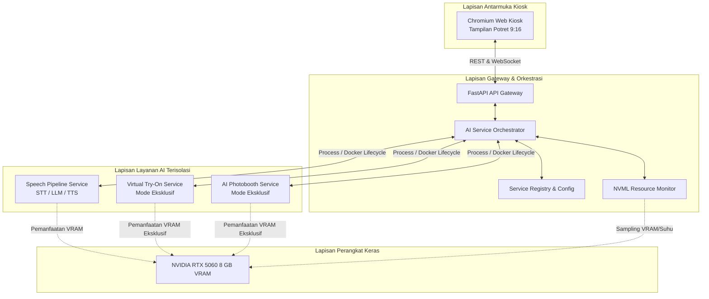

# diagram_guide.md — Panduan Visual & Ekspor Diagram Skripsi

> **Lokasi:** `docs/writing/diagram_guide.md`  
> **Fungsi:** Spesifikasi standar visual diagram skripsi (warna, font, resolusi 300 DPI), protokol ekspor otomatis PNG, dan template diagram acuan.  
> **Kapan AI membaca:** Saat merancang diagram baru atau mengekspor diagram ke aset skripsi.

---

## 1. Standar Visual Diagram Skripsi

Diagram dalam naskah skripsi harus memiliki keterbacaan tinggi (*high readability*), tipografi bersih, kontras warna yang baik saat dicetak hitam-putih, dan resolusi minimum **300 DPI** agar tidak pecah saat dimasukkan ke Microsoft Word / LaTeX.

1. **Background:** Wajib putih bersih (`#FFFFFF`), jangan gunakan latar transparan atau gelap karena akan rusak saat dicetak di kertas skripsi.
2. **Font:** Gunakan font sans-serif standar akademik (seperti *Arial*, *Helvetica*, atau *Inter*) dengan ukuran proporsional (teks tidak boleh terlalu kecil dibanding kotak proses).
3. **Warna Elemen:**
   - Garis batas kotak (*stroke*): Abu-abu gelap atau hitam tegas (`#1F2937` / `#000000`), ketebalan 1.5–2 pt.
   - Kotak proses biasa: Latar putih atau abu-abu sangat terang (`#F9FAFB`).
   - Kotak keputusan / Orchestrator inti: Biru muda lembut (`#E0F2FE`) dengan garis biru tegas (`#0284C7`).
   - Kotak hardware / GPU: Hijau lembut (`#DCFCE7`) dengan garis hijau tegas (`#16A34A`).
   - Kotak error / peringatan: Merah muda lembut (`#FEE2E2`) dengan garis merah tegas (`#DC2626`).
4. **Teks Label:** Gunakan Bahasa Indonesia formal untuk diagram arsitektur utama atau istilah teknis standar (misal: *Readiness Check*, *Inference Request*).

---

## 2. Protokol Ekspor Otomatis ke PNG (Zero Manual Steps)

Setiap perancangan diagram Mermaid wajib diekspor ke file fisik `.png` beresolusi tinggi di direktori `assets/diagrams/`:
- **Latar belakang:** Putih solid (`#ffffff`).
- **Kualitas:** Resolusi tinggi (skala 3x setara 300 DPI).
- **Lokasi keluaran:** `assets/diagrams/<nama_diagram>.png`.
- **Skrip bantu:** Skrip render di folder `scripts/` (misal `scripts/export_diagram.py`).

---

## 3. Template Diagram Acuan Skripsi

### 3.1 State Machine Lifecycle Layanan AI
```mermaid
stateDiagram-v2
    direction LR
    classDef default fill:#F9FAFB,stroke:#1F2937,stroke-width:1.5px
    classDef active fill:#E0F2FE,stroke:#0284C7,stroke-width:2px
    classDef alert fill:#FEE2E2,stroke:#DC2626,stroke-width:1.5px

    [*] --> STOPPED
    STOPPED --> STARTING: Perintah Load / Switch
    STARTING --> READY: Readiness Check Sukses
    STARTING --> ERROR: Timeout / Kegagalan Alokasi
    READY --> STOPPING: Perintah Unload / Mode Eksklusif
    STOPPING --> STOPPED: Proses Berhenti & VRAM Dilepas
    READY --> ERROR: Crash / CUDA OOM
    ERROR --> STOPPED: Pemulihan / Cleanup

    class READY active
    class ERROR alert
```

### 3.2 Diagram Arsitektur Microservices


---

## 4. Tata Cara Penyisipan Gambar ke Dalam Naskah
1. Setiap gambar pada naskah wajib memiliki nomor dan judul di bawah gambar (contoh: **Gambar 3.2 Diagram Alir Transisi Layanan AI**).
2. Setiap gambar wajib dirujuk (*cross-referenced*) dalam teks narasi sebelum gambar muncul (contoh: *"Arsitektur sistem yang diusulkan diilustrasikan pada Gambar 3.2..."*).
3. Gambar tidak boleh berdiri sendiri tanpa paragraf pengantar dan pembahasan fungsi dari masing-masing blok komponen.
