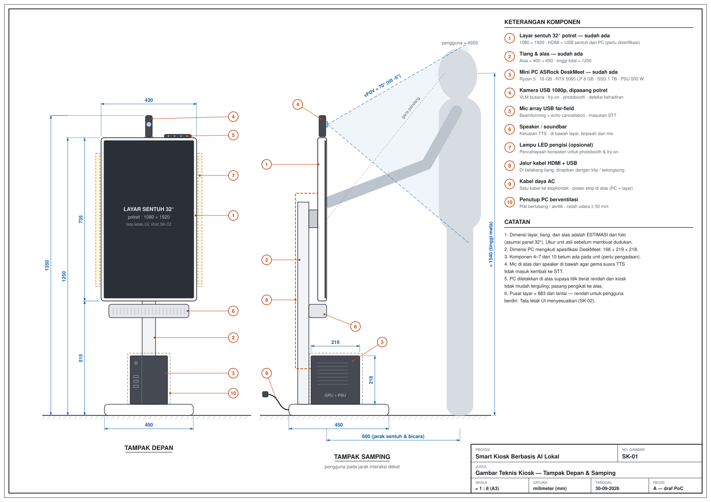
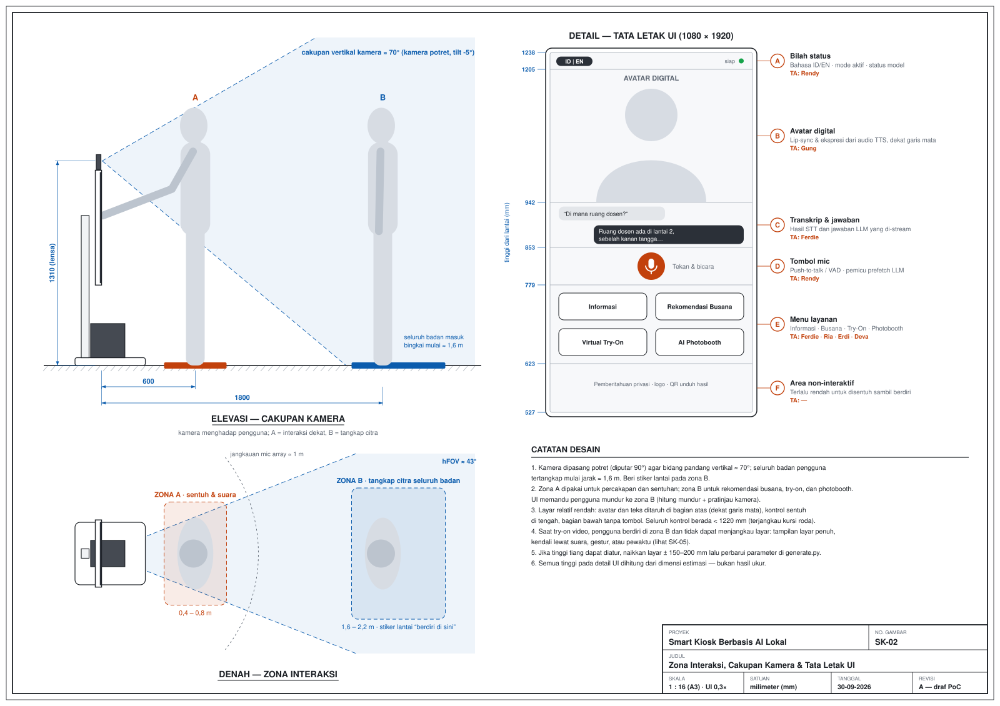
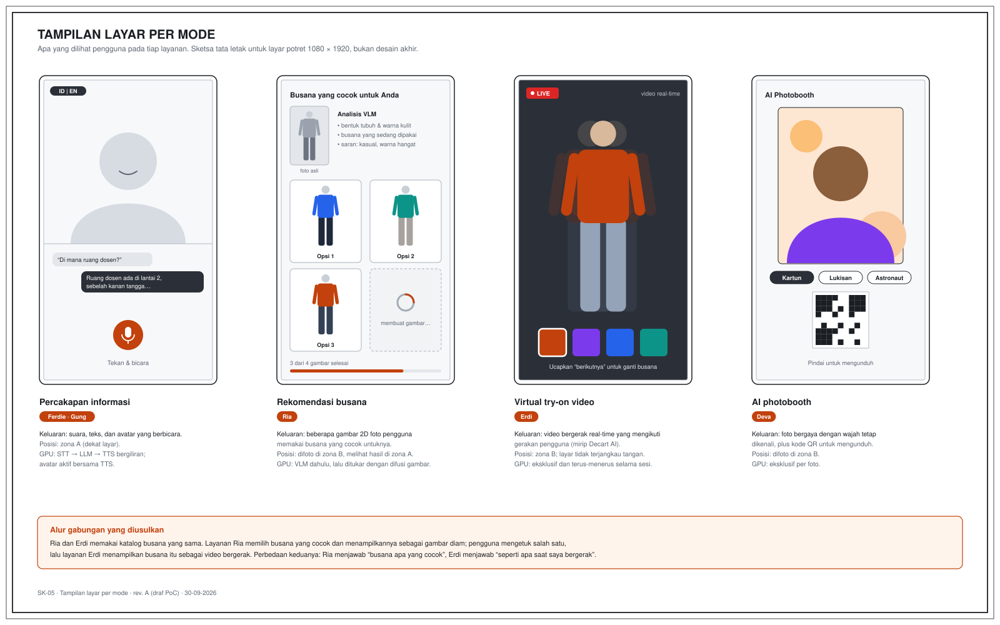
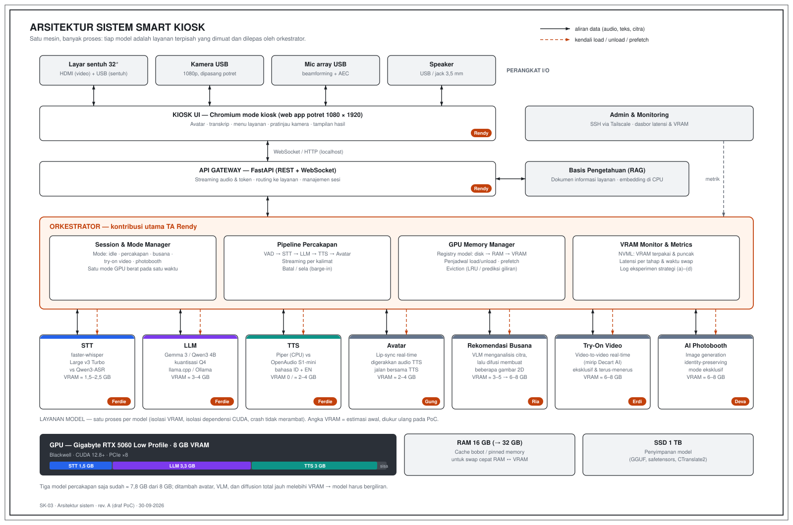
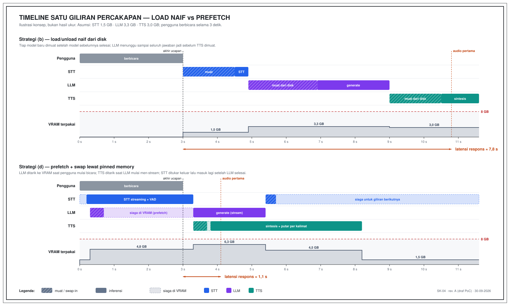

# Proof of Concept — Smart Kiosk Berbasis AI Lokal

Draf rev. A · 30 September 2026 · Laboratorium MIoT

Dokumen ini menjelaskan apa yang ingin dibuktikan oleh proof of concept (PoC), seperti apa bentuk fisik kiosknya, bagaimana enam tugas akhir berbagi satu mesin, dan kapan PoC dianggap berhasil.

> **Tentang angka di dokumen ini.** Dimensi layar dan tiang adalah estimasi dari foto. Kebutuhan VRAM tiap model adalah perkiraan awal. Target latensi adalah usulan. Semuanya ditandai "≈" atau "estimasi" dan harus diganti dengan hasil ukur pada tahap PoC-0 dan PoC-1.

---

## 1. Apa yang dibuktikan

Satu pertanyaan inti:

> Bisakah enam fitur AI lokal hidup di satu mini PC dengan GPU 8 GB, dengan latensi percakapan yang masih terasa wajar?

PoC menjawabnya lewat tiga pembuktian berurutan:

1. **Pipeline suara berjalan lokal** dalam bahasa Indonesia dan Inggris (STT → LLM → TTS), tanpa API cloud.
2. **Orkestrator dapat menggilir model** sehingga VRAM tidak pernah melewati 8 GB, dan latensi dari akhir ucapan sampai audio pertama tetap beberapa detik saja.
3. **Fitur berat berbasis citra** (rekomendasi busana, try-on video, photobooth, avatar) dapat masuk dan keluar GPU lewat orkestrator yang sama tanpa membuat kiosk macet.

PoC bukan produk jadi. Tiap fitur cukup satu irisan tipis dari ujung ke ujung; kualitas model disempurnakan di masing-masing TA.

## 2. Enam TA di satu platform

| Nama   | Judul                                                                             | Layanan di platform                       | I/O yang dipakai             | Pola pemakaian GPU                                |
| ------ | --------------------------------------------------------------------------------- | ----------------------------------------- | ---------------------------- | ------------------------------------------------- |
| Rendy  | Sistem Orkestrasi Layanan AI Berbasis Microservices pada Smart Kiosk              | Gateway, orkestrator, UI kiosk            | semua                        | tidak memakai GPU; mengatur GPU                   |
| Ferdie | Agen Percakapan Multi Bahasa untuk Layanan Informasi Menggunakan Open Weight LLM  | STT, LLM, TTS                             | mic, speaker, layar          | bergiliran per giliran bicara                     |
| Gung   | Avatar Digital Real-Time dengan Sinkronisasi Lip-Sync dan Ekspresi Berbasis Audio | Avatar                                    | layar, audio TTS             | harus jalan bersamaan dengan TTS                  |
| Ria    | Vision-Language Model untuk Rekomendasi Busana Berbasis Analisis Visual           | Rekomendasi busana: VLM + generasi gambar | kamera, layar, speaker       | dua tahap per permintaan: VLM, lalu difusi gambar |
| Erdi   | Virtual Try-On Berbasis Diffusion Model Lokal                                     | Try-on video real-time                    | kamera (aliran video), layar | eksklusif dan terus-menerus selama sesi           |
| Deva   | AI Photobooth dengan Identity-Preserving menggunakan Image Generation             | Photobooth                                | kamera, layar                | eksklusif (model lain dilepas)                    |

Bentuk keluaran tiap layanan citra berbeda, dan ini menentukan cara GPU dipakai:

- **Ria** menghasilkan **beberapa gambar 2D**: foto pengguna yang tertangkap kamera, ditampilkan memakai busana yang cocok untuknya. VLM menganalisis dan memilih busana; model difusi gambar membuat fotonya.
- **Erdi** menghasilkan **video bergerak** yang mengikuti gerakan pengguna secara langsung, mirip Decart AI. Kiosk berperan seperti cermin.
- **Deva** menghasilkan **satu foto bergaya** dengan wajah pengguna tetap dikenali.

Ria menjawab "busana apa yang cocok", Erdi menjawab "seperti apa busana itu saat saya bergerak". Keduanya sebaiknya memakai katalog busana yang sama, sehingga hasil Ria bisa langsung dilanjutkan ke Erdi.

Pembagian tanggung jawab: tiap TA model memilih dan mengevaluasi modelnya sendiri, lalu membungkusnya sebagai layanan dengan kontrak yang sama (bagian 5.2). Rendy memastikan semua layanan itu muat bergantian di satu GPU.

## 3. Perangkat keras

### 3.1 Yang sudah ada

| Komponen | Spesifikasi (dari `pc-spec.txt` dan foto) |
|---|---|
| Mini PC | ASRock DeskMeet, casing 8 liter, 168 × 219 × 218 mm, PSU internal 500 W |
| CPU / RAM / SSD | AMD Ryzen 5 · 16 GB · 1 TB |
| GPU | Gigabyte RTX 5060 Low Profile, 8 GB VRAM (Blackwell; perlu driver seri 570+, CUDA 12.8+, PyTorch 2.7+) |
| OS | Ubuntu (desktop GNOME), akses jarak jauh lewat Tailscale |
| Layar | Layar sentuh potret di tiang dengan alas, warna putih; diasumsikan 32″ 1080 × 1920 |

### 3.2 Yang perlu ditambah

| Komponen | Untuk apa | Catatan pemilihan |
|---|---|---|
| Kamera USB 1080p, 30 fps | Rekomendasi busana, try-on video, photobooth, deteksi kehadiran | Dipasang potret (diputar 90°) supaya seluruh badan masuk bingkai pada jarak ≈ 1,6 m. Untuk try-on video, pilih kamera dengan jeda rendah (UVC, MJPEG) |
| Mic array USB far-field | Masukan STT | Pilih yang punya echo cancellation bawaan, karena speaker menyala saat TTS berbicara |
| Speaker / soundbar kecil | Keluaran TTS | Dipasang di bawah layar, jauh dari mic. Tidak perlu jika speaker bawaan layar bisa dipakai lewat HDMI |
| Lampu LED pengisi (opsional) | Photobooth, rekomendasi busana, try-on video | Hasil diffusion sangat peka terhadap pencahayaan; lampu membuat hasil konsisten |
| Dudukan dan penutup PC | Keamanan dan kerapian | Plat berlubang atau akrilik; jangan menutup aliran udara GPU dan PSU |
| RAM tambahan (ke 32 GB) | Cache bobot model di RAM | Lihat bagian 6.4. Tipe modul bergantung pada temuan 3.3 nomor 1 |

### 3.3 Yang harus dicek sebelum mulai

1. **Tipe motherboard tidak cocok antara catatan dan foto.** `pc-spec.txt` menulis DeskMeet X300 dengan DDR4, tetapi hostname di terminal pada foto terbaca `tugasakhir-X600-ITX`. Ubuntu membuat hostname bawaan dari nama produk motherboard, jadi kemungkinan besar mesinnya DeskMeet **X600** (AM5, DDR5, PCIe 4.0), bukan X300 (AM4, DDR4, PCIe 3.0). Ini menentukan dua hal: jenis RAM yang harus dibeli, dan kecepatan swap RAM ↔ VRAM.
2. **Kecepatan link PCIe.** RTX 5060 hanya memakai 8 lane. Di slot PCIe 3.0 batas teoretisnya ≈ 7,9 GB/s; di PCIe 4.0 ≈ 15,8 GB/s. Artinya memindahkan bobot 2,5 GB dari pinned memory butuh kira-kira 0,4 detik di X300 atau 0,2 detik di X600. Angka 0,2–0,3 detik di rencana awal hanya realistis pada PCIe 4.0.
3. **Layar sentuh ke PC.** Layar jenis ini sering punya Android bawaan. Pastikan ada masukan HDMI **dan** keluaran USB sentuh ke PC luar. Jika sentuhan hanya bekerja untuk Android internal, UI kiosk tidak bisa disentuh dan rancangan harus berubah.
4. **Ukuran asli layar, tiang, dan alas.** Gambar teknis memakai estimasi; ukur lalu perbarui parameter di `gambar/generate.py`.
5. **Daya.** PSU 500 W cukup untuk GPU ≈ 145 W ditambah CPU, tetapi tetap pantau suhu dan stabilitas saat beban penuh di dalam penutup.

Perintah untuk mengecek nomor 1, 2, dan 3:

```bash
sudo dmidecode -s baseboard-product-name                 # X300-ITX atau X600-ITX
sudo dmidecode -t memory | grep -E "Type:|Size:|Speed:"  # DDR4 atau DDR5, slot terisi
sudo lspci -vv -d 10de: | grep -E "LnkCap:|LnkSta:"      # 8GT/s = PCIe 3.0, 16GT/s = PCIe 4.0
nvidia-smi --query-gpu=name,memory.total,driver_version --format=csv
sudo libinput list-devices | grep -i -A3 touch           # layar sentuh terdeteksi?
```

## 4. Gambar teknis kiosk

Kelima gambar dibuat oleh `gambar/generate.py` (Python standar, tanpa dependensi). Tersedia sebagai SVG dan PNG resolusi tinggi untuk laporan.

### SK-01 — Tampak depan dan samping



Keputusan rancangan:

- **PC diletakkan di alas**, di depan tiang dan di bawah layar. Titik berat jadi rendah sehingga kiosk tidak mudah terguling, dan kabel ke layar pendek. Alternatifnya rak di belakang tiang, tetapi tiang berada di tepi belakang alas sehingga beban ≈ 5 kg di sana menambah risiko terguling ke belakang.
- **Kamera dan mic di tepi atas layar, speaker di bawah.** Tepi atas paling dekat dengan wajah pengguna. Memisahkan mic dari speaker mengurangi suara TTS yang terdengar kembali oleh STT.
- **Satu kabel daya keluar dari kiosk.** PC memakai listrik AC, jadi kiosk tidak bisa berjalan dari baterai layar saja.

### SK-02 — Zona interaksi, cakupan kamera, dan tata letak UI



- **Dua zona berdiri.** Zona A (0,4–0,8 m) untuk bicara dan menyentuh. Zona B (1,6–2,2 m) untuk fitur yang butuh citra seluruh badan. UI perlu memandu pengguna mundur ke zona B.
- **Di zona B layar tidak terjangkau tangan.** Selama try-on video pengguna berdiri di sana terus, jadi kendalinya harus lewat suara, gestur, atau pewaktu, bukan tombol sentuh.
- **Layar cukup rendah untuk pengguna berdiri** (pusat layar ≈ 0,88 m, tinggi mata ≈ 1,54 m). Karena itu avatar dan teks ditaruh di bagian atas layar, kontrol sentuh di tengah, dan bagian bawah tidak diberi tombol. Sisi baiknya, semua kontrol terjangkau pengguna kursi roda.

### SK-05 — Tampilan layar per mode



Empat tampilan ini memperlihatkan beda keluaran tiap layanan: percakapan dengan avatar, galeri gambar diam dari Ria, video langsung layar penuh dari Erdi, dan foto bergaya dari Deva.

## 5. Arsitektur sistem



### 5.1 Komponen

| Lapisan | Isi | Teknologi usulan |
|---|---|---|
| UI kiosk | Web app potret: avatar, transkrip, menu layanan, pratinjau kamera | Chromium mode kiosk |
| API gateway | Satu pintu masuk; streaming audio dan token | FastAPI, WebSocket |
| Orkestrator | Manajer sesi dan mode, pipeline percakapan, manajer memori GPU, pencatat metrik | Python, NVML |
| Layanan model | Satu proses per model: STT, LLM, TTS, avatar, rekomendasi busana, try-on video, photobooth | faster-whisper, llama.cpp / Ollama, Piper, PyTorch |
| Penyimpanan | Bobot model di SSD, cache bobot di RAM, basis pengetahuan untuk jawaban informasi | sistem berkas, SQLite atau Chroma |

### 5.2 Kontrak layanan model

Setiap layanan model, apa pun isinya, menyediakan endpoint yang sama supaya orkestrator bisa memperlakukannya seragam:

| Endpoint | Fungsi |
|---|---|
| `GET /health` | Status: `unloaded`, `in_ram`, `in_vram`, `busy` |
| `POST /load` | Pindahkan bobot ke VRAM; kembalikan waktu muat |
| `POST /unload` | Lepas dari VRAM; parameter `keep_in_ram` menentukan apakah bobot tetap di RAM |
| `POST /infer` atau WebSocket | Inferensi; streaming bila model mendukung |
| `GET /metrics` | VRAM terpakai, VRAM puncak, latensi terakhir |

Di berkas registry, tiap layanan mendeklarasikan perkiraan VRAM, waktu muat, dan apakah ia eksklusif. Orkestrator mengambil keputusan dari data itu dan dari pembacaan NVML.

### 5.3 Kenapa bukan monolith

- **VRAM benar-benar kembali.** `torch.cuda.empty_cache()` tidak selalu mengembalikan semua memori; mematikan proses selalu mengembalikannya.
- **Dependensi bertabrakan.** CTranslate2, llama.cpp, dan pipeline diffusion memerlukan versi CUDA, cuDNN, dan PyTorch yang berbeda. Proses terpisah berarti environment terpisah.
- **Crash tidak merambat.** Kehabisan memori di layanan try-on video tidak mematikan percakapan.
- **Enam orang bekerja paralel.** Tiap TA menyerahkan satu layanan dengan kontrak yang jelas.

Biaya yang perlu diakui dan diukur: setiap proses yang memakai GPU membawa konteks CUDA sendiri, yang memakan VRAM dalam orde ratusan MB walau modelnya sedang dilepas. Dengan banyak layanan, overhead ini bisa mencapai lebih dari 1 GB. Karena itu layanan eksklusif (try-on video, photobooth, difusi gambar milik Ria) sebaiknya dinyalakan saat dibutuhkan dan dimatikan setelah selesai, bukan dibiarkan hidup.

## 6. Anggaran VRAM dan strategi orkestrasi

### 6.1 Perkiraan kebutuhan per model

| Layanan | Kandidat | VRAM (estimasi) | Catatan |
|---|---|---|---|
| STT | faster-whisper Large v3 Turbo; Qwen3-ASR | ≈ 1,5–2,5 GB | WER bahasa Indonesia diukur sendiri (FLEURS, Common Voice) |
| LLM | Gemma 3 4B, Qwen3 4B, pembanding lain; kuantisasi Q4 | ≈ 3–4 GB | Termasuk konteks; bertambah seiring panjang konteks |
| TTS | Piper (CPU); OpenAudio S1-mini | 0 atau ≈ 2–4 GB | Piper tidak memakai VRAM sama sekali |
| Avatar | model lip-sync real-time | ≈ 2–4 GB | Aktif bersamaan dengan TTS |
| Rekomendasi busana, tahap 1 | VLM kelas 3–4B Q4 | ≈ 3–5 GB | Menganalisis foto dan memilih busana. Gemma 3 4B sudah multimodal: satu model bisa merangkap LLM dan VLM |
| Rekomendasi busana, tahap 2 | difusi try-on gambar, atau model edit gambar | ≈ 6–8 GB | Membuat beberapa gambar; puluhan detik per gambar. Tidak muat bersama VLM, jadi VLM dilepas dahulu |
| Try-on video | difusi video-to-video real-time hasil distilasi (1–4 langkah) | ≈ 6–8 GB | Memegang GPU terus-menerus selama sesi; layanan paling berat di platform |
| Photobooth | image generation identity-preserving | ≈ 6–8 GB | Sama; varian SDXL mungkin perlu offload ke CPU |

Jumlah tiga model percakapan saja ≈ 7,8 GB. Seluruh model jauh di atas 8 GB.

### 6.2 Mode kiosk

Orkestrator bekerja di dua tingkat. Perpindahan **mode** itu kasar dan jarang: semua model mode lama dilepas. Perpindahan **dalam giliran bicara** itu halus dan sering: model ditukar dalam sepersekian detik.

| Mode | Model yang aktif | Perilaku GPU |
|---|---|---|
| Idle | deteksi kehadiran di CPU, STT siaga | hampir kosong |
| Percakapan informasi | STT → LLM → TTS, ditambah avatar | tukar per giliran bicara |
| Rekomendasi busana | kamera → VLM → difusi gambar (beberapa kali) → galeri | VLM dimuat, dilepas, lalu difusi dimuat; gambar ditampilkan satu per satu begitu jadi |
| Try-on video | aliran kamera → difusi video → layar, terus-menerus | eksklusif selama sesi; tidak ada pertukaran model di tengah sesi |
| Photobooth | image generation | eksklusif; UI menampilkan hitung mundur dan progres |

### 6.3 Strategi yang dibandingkan

| Strategi | Cara kerja | Dugaan awal |
|---|---|---|
| (a) Semua resident | Pakai model kecil supaya semuanya muat sekaligus | Latensi terbaik, kualitas model terendah |
| (b) Load/unload naif | Muat dari disk tiap kali dibutuhkan | Paling sederhana, latensi terburuk |
| (c) Swap pinned memory | Bobot tetap di RAM, dipindah ke VRAM lewat PCIe | Cepat, tetapi boros RAM |
| (d) Prefetch | Seperti (c), dan model berikutnya dimuat sebelum dibutuhkan | Latensi mendekati (a) dengan model yang lebih besar |



Gambar di atas adalah ilustrasi, bukan hasil ukur. Intinya: total tiga model melebihi VRAM, tetapi **pasangan yang bersebelahan muat** (STT + LLM ≈ 4,8 GB, LLM + TTS ≈ 6,3 GB). Prefetch memanfaatkan itu: model berikutnya sudah di VRAM sebelum model sekarang selesai.

### 6.4 Hal yang perlu diperhatikan saat eksperimen

- **Strategi (b) punya dua wajah.** Muat pertama membaca SSD; muat berikutnya membaca page cache di RAM dan jauh lebih cepat. Ukur keduanya terpisah (kosongkan page cache untuk kondisi dingin), kalau tidak (b) akan tampak lebih baik dari yang sebenarnya.
- **Strategi (c) tidak tersedia di semua runtime.** llama.cpp dan Ollama melepas lalu memuat ulang dari berkas; mereka tidak menyimpan bobot di pinned memory. Swap pinned memory yang sesungguhnya hanya ada pada layanan berbasis PyTorch (`.to("cuda")`) atau vLLM sleep mode. Untuk LLM, perbandingan yang jujur adalah "llama.cpp muat ulang dari page cache" lawan "PyTorch/vLLM swap".
- **RAM 16 GB sempit untuk (c) dan (d).** Menyimpan bobot STT + LLM + TTS di RAM memakan ≈ 8 GB, belum termasuk OS, browser, dan proses Python tiap layanan. Bobot VLM dan diffusion tidak akan muat di cache. Inilah alasan teknis upgrade ke 32 GB.
- **Avatar memecah asumsi "satu model pada satu waktu".** Saat kiosk berbicara, TTS dan avatar harus aktif bersamaan, sementara LLM mungkin masih men-stream. LLM ≈ 3,3 GB + avatar ≈ 4 GB sudah mendekati batas bahkan dengan Piper di CPU. Rendy dan Gung perlu menyepakati anggaran VRAM avatar sejak awal, dan menyiapkan cadangan (avatar lebih ringan, atau avatar mulai setelah LLM selesai satu kalimat).
- **Try-on video adalah layanan paling berisiko di perangkat ini.** Decart menjalankan modelnya di GPU pusat data. Di RTX 5060 8 GB, video real-time berbasis difusi hanya realistis dengan model hasil distilasi 1–4 langkah, resolusi rendah, dan akselerasi seperti TensorRT. Kualitas setara Decart kemungkinan tidak tercapai; yang perlu dibuktikan lebih dulu di PoC-0 adalah berapa fps dan berapa jeda yang bisa dicapai. Siapkan cadangan: klip pendek yang dirender beberapa puluh detik lalu diputar berulang.
- **Try-on video menutup GPU untuk layanan lain.** Selama sesi, STT, LLM, dan avatar tidak bisa dimuat. Kalau pengguna perlu memberi perintah ("berikutnya", "selesai"), pengenalnya harus jalan di CPU: pendeteksi kata kunci, STT kecil di CPU, gestur tangan, atau pewaktu.
- **Rekomendasi busana punya pertukaran model di dalam satu permintaan.** VLM dan difusi gambar tidak muat bersama, sehingga orkestrator menukar keduanya sementara pengguna menunggu. Tampilkan hasil analisis VLM sebagai teks lebih dulu, lalu gambar satu per satu, supaya waktu tunggu tidak terasa kosong.
- **Ria dan Erdi beririsan.** Keduanya memakaikan busana ke tubuh pengguna; bedanya gambar diam lawan video. Sepakati sejak awal katalog busana bersama dan praproses bersama (segmentasi tubuh, pose), supaya tidak ada dua model praproses yang memakan VRAM untuk pekerjaan yang sama.
- **Sisakan ruang.** Targetkan puncak ≤ 7,5 GB. Desktop Ubuntu dan Chromium juga memakai VRAM beberapa ratus MB.

## 7. Skenario demo

Satu alur berurutan yang menyentuh keenam TA:

1. Pengguna mendekat. Kiosk mendeteksi kehadiran, avatar menyapa.
2. Pengguna menekan tombol mic dan bertanya dalam bahasa Indonesia, misalnya "Di mana ruang dosen?". Kiosk menjawab dengan suara, teks, dan avatar.
3. Pengguna bertanya lagi dalam bahasa Inggris. Kiosk menjawab dalam bahasa Inggris.
4. Pengguna memilih **Rekomendasi Busana**. UI memintanya mundur ke zona B dan kamera mengambil foto. Layar menampilkan analisis VLM, lalu beberapa gambar pengguna memakai busana yang cocok, muncul satu per satu.
5. Pengguna mengetuk salah satu gambar dan memilih **Virtual Try-On**, lalu mundur lagi ke zona B. Layar menjadi cermin: video langsung pengguna memakai busana itu, mengikuti gerakannya. Sesi berakhir lewat perintah suara atau pewaktu.
6. Pengguna memilih **AI Photobooth**. Hitung mundur, foto, hasil tampil bersama kode QR untuk mengunduh di jaringan lokal.
7. Pengguna kembali bertanya lewat suara. Percakapan harus pulih tanpa memulai ulang aplikasi.

Langkah 7 adalah ujian orkestrator yang sesungguhnya: kembali dari mode eksklusif ke percakapan.

## 8. Tahapan dan kriteria lulus

| Tahap | Isi | Lulus jika |
|---|---|---|
| **PoC-0** Lingkungan | Cek perangkat keras (3.3), driver, CUDA, PyTorch; tiap kandidat model dijalankan sendiri-sendiri | Semua model jalan di RTX 5060; VRAM puncak dan waktu muat tiap model tercatat; layar sentuh, kamera, mic, dan speaker terbaca |
| **PoC-1** Pipeline suara dasar | STT → LLM → TTS dengan strategi (a), model kecil, tanpa orkestrator | Tanya jawab suara ID dan EN berjalan dari ujung ke ujung; latensi per tahap tercatat sebagai garis dasar |
| **PoC-2** Orkestrator | Kontrak layanan, registry, strategi (b), (c), (d); skrip uji otomatis | 100 giliran berturut-turut tanpa kehabisan memori; VRAM puncak ≤ 7,5 GB; tabel perbandingan empat strategi tersedia |
| **PoC-3** Model keempat dan mode eksklusif | Avatar, rekomendasi busana (VLM + gambar), try-on video, photobooth masuk lewat kontrak yang sama | Skenario demo langkah 4 sampai 7 berjalan; perpindahan mode tidak memerlukan restart |
| **PoC-4** Kiosk utuh | UI potret, perangkat terpasang di tiang, autostart | Skenario demo penuh dijalankan orang yang belum pernah memakai kiosk; kiosk bertahan 8 jam menyala tanpa VRAM bocor |

Target latensi yang diusulkan (untuk disepakati dengan pembimbing):

| Ukuran | Target | Batas terima |
|---|---|---|
| Akhir ucapan → audio pertama, mode percakapan | ≤ 2 detik | ≤ 3 detik |
| Swap satu model masuk VRAM | ≤ 0,5 detik | ≤ 1 detik |
| Pindah mode percakapan ↔ eksklusif | ≤ 5 detik | ≤ 10 detik, dengan animasi transisi |
| Rekomendasi busana: foto → gambar pertama | ≤ 30 detik | ≤ 60 detik |
| Rekomendasi busana: 4 gambar lengkap | ≤ 2 menit | ≤ 3 menit |
| Try-on video: laju bingkai pada ≈ 512 × 768 | ≥ 15 fps | ≥ 8 fps |
| Try-on video: jeda kamera → layar | ≤ 300 ms | ≤ 700 ms |

## 9. Metrik dan cara ukur

| Metrik | Cara ukur | Pemilik |
|---|---|---|
| Latensi ujung ke ujung per giliran | Cap waktu di gateway: akhir ucapan (VAD), teks STT final, token pertama, audio pertama | Rendy |
| Waktu swap per model | Dicatat layanan pada `/load` dan `/unload` | Rendy |
| VRAM puncak | NVML, dicuplik tiap 50–100 ms selama uji | Rendy |
| WER bahasa Indonesia dan Inggris | FLEURS dan Common Voice, ditambah rekaman lewat mic kiosk di ruangan sebenarnya | Ferdie |
| Kualitas jawaban LLM | Kumpulan pertanyaan informasi layanan ID/EN dengan rubrik penilaian | Ferdie |
| Kualitas TTS | MOS dari responden, waktu sampai audio pertama, real-time factor | Ferdie |
| Avatar | fps, selisih waktu audio–bibir | Gung |
| Rekomendasi busana | Kesesuaian rekomendasi (penilaian responden), kemiripan orang pada gambar hasil, waktu sampai gambar pertama dan sampai semua gambar | Ria |
| Try-on video | fps, jeda kamera → layar, konsistensi antar-bingkai (kedip, busana berubah bentuk), VRAM puncak | Erdi |
| Photobooth | Kemiripan wajah dengan foto asli, waktu per foto, VRAM puncak | Deva |

Semua uji beban memakai rekaman audio dan gambar yang sama supaya hasil antar-strategi bisa dibandingkan.

## 10. Risiko

| Risiko | Dampak | Mitigasi |
|---|---|---|
| Layar sentuh tidak mengirim sentuhan ke PC | UI tidak bisa dipakai | Cek di PoC-0; cadangan: kiosk sepenuhnya suara, atau ganti layar |
| Pustaka belum mendukung Blackwell | Model tidak jalan di GPU | Cek tiap runtime di PoC-0 (CTranslate2, llama.cpp, PyTorch cu128) |
| Try-on video real-time tidak tercapai di 8 GB | Keluaran Erdi patah-patah atau terlalu lambat | Ukur fps di PoC-0 sebelum merancang lebih jauh; turunkan resolusi dan langkah difusi; cadangan klip pendek yang dirender |
| Waktu tunggu rekomendasi busana terlalu lama | Pengguna pergi sebelum gambar jadi | Tampilkan analisis teks lebih dulu, gambar satu per satu; kurangi jumlah gambar atau resolusi |
| Avatar + LLM + TTS melebihi 8 GB | Percakapan dengan avatar gagal | Anggaran VRAM avatar disepakati dini; Piper di CPU; avatar cadangan yang ringan |
| Overhead konteks CUDA per proses | VRAM efektif menyusut | Ukur di PoC-0; layanan eksklusif dimatikan saat tidak dipakai |
| RAM 16 GB tidak cukup untuk cache bobot | Strategi (c) dan (d) tidak bisa diuji penuh | Upgrade ke 32 GB setelah tipe RAM dipastikan |
| Gema TTS masuk ke mic | STT menyalin suara kiosk sendiri | Mic dengan echo cancellation; STT dibungkam saat TTS berbicara |
| Bising ruangan dan pencahayaan berubah-ubah | WER naik; hasil citra tidak konsisten | Uji di lokasi sebenarnya; lampu pengisi; stiker posisi berdiri |
| Citra wajah dan badan pengguna | Privasi | Proses lokal, tidak disimpan tanpa persetujuan, pemberitahuan di layar, hapus otomatis |
| Lisensi model non-komersial | Membatasi pemakaian di luar riset | Catat lisensi tiap model di registry; aman untuk TA, perlu ditinjau bila kiosk dipakai komersial |

## 11. Usulan struktur repositori

```
smart-kiosk/
├── PROOF_OF_CONCEPT.md
├── gambar/                  # gambar teknis + generator
├── gateway/                 # FastAPI: REST + WebSocket
├── orchestrator/            # mode manager, pipeline, GPU memory manager
│   └── registry.yaml        # daftar layanan: port, estimasi VRAM, eksklusif atau tidak
├── services/
│   ├── stt/  llm/  tts/     # Ferdie
│   ├── avatar/              # Gung
│   ├── busana/              # Ria: VLM + generasi gambar
│   ├── tryon-video/         # Erdi
│   ├── praproses/           # segmentasi tubuh & pose, dipakai bersama
│   └── photobooth/          # Deva
├── katalog/                 # gambar busana, dipakai Ria dan Erdi
├── ui/                      # web app potret 1080 × 1920
├── bench/                   # skrip uji beban + rekaman uji
└── docs/
```

Tiap folder layanan punya environment Python sendiri dan dijalankan sebagai unit systemd atau kontainer terpisah.

## 12. Berkas di folder ini

| Berkas | Isi |
|---|---|
| `monitor-kiosk.jpeg`, `pc-kiosk.jpeg`, `pc-spec.txt` | Foto dan spesifikasi perangkat |
| `gambar/01-gambar-teknis-kiosk.svg` | SK-01: tampak depan dan samping, dimensi, komponen |
| `gambar/02-zona-interaksi-dan-ui.svg` | SK-02: cakupan kamera, zona berdiri, tata letak UI |
| `gambar/03-arsitektur-sistem.svg` | SK-03: arsitektur perangkat lunak dan pembagian TA |
| `gambar/04-timeline-vram.svg` | SK-04: ilustrasi load naif lawan prefetch |
| `gambar/05-tampilan-per-mode.svg` | SK-05: tampilan layar tiap layanan (percakapan, galeri gambar, video langsung, photobooth) |
| `gambar/*.png` | Versi PNG 3200 px untuk laporan dan slide |
| `gambar/generate.py` | Generator kelima gambar; ubah parameter di bagian atas lalu jalankan `python3 gambar/generate.py` |
